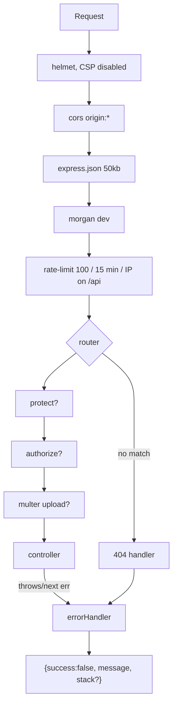
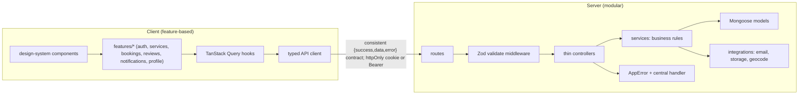
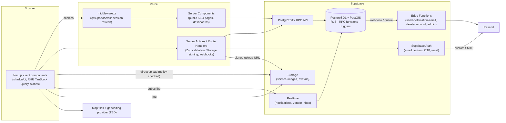

# System Architecture

> **Document structure (revised 2026-11-17)**
> - **Part A: Current implementation (MERN, audited).** Unchanged from the initial audit.
> - **Part B: Target architecture (Supabase + Next.js).** Supabase PostgreSQL is **Approved** (ADR-001). The rest of Part B was **Approved** on 2026-11-17 (ADR-002 to ADR-019).
>
> Decision status is tracked in [../planning/DECISIONS.md](../planning/DECISIONS.md).

# Part A — Current implementation (MERN)


## Current implementation

### Repository layout
```
Veny-Mern-FullStack/
├── .gitignore
├── package.json            # root: only "axios" dependency, unused, no scripts
├── package-lock.json
├── Client/veny-frontend/   # React 19 + Vite 8 SPA (JavaScript)
└── Server/                 # Express 5 + Mongoose 9 API (CommonJS)
```
- There is one frontend and one backend. It is **not** a workspace or monorepo tool setup: no npm workspaces, no Turborepo. Each app installs and runs independently.
- There are no tests, no CI configuration, no Dockerfile and no `.env.example`.

### System context

```mermaid
flowchart LR
    subgraph Browser
      SPA["React SPA (Vercel)"]
    end
    subgraph Render
      API["Express API :PORT"]
    end
    DB[(MongoDB<br/>MONGO_URI)]
    CL[Cloudinary<br/>image storage]
    RS[Resend<br/>transactional email]
    EJ[EmailJS<br/>browser email]
    NOM[Nominatim / OSM<br/>reverse geocoding]
    CARTO[CARTO dark tiles]
    TT[transparenttextures.com<br/>bg image]

    SPA -- "REST /api/* Bearer JWT" --> API
    API --> DB
    API -- multer-storage-cloudinary --> CL
    API -- "notifications, resend-otp" --> RS
    SPA -- "OTP on signup/login" --> EJ
    SPA -- "reverse geocode (signup)" --> NOM
    SPA -- map tiles --> CARTO
    SPA -- CSS bg --> TT
    SPA -- "img src" --> CL
```



### Runtime requirements
| App | Requirement | Source |
|---|---|---|
| Server | Node **≥ 20.19.0** | engines field of mongoose 9.6.2 in `Server/package-lock.json` |
| Client | Node **^20.19.0 or ≥ 22.12.0** | engines field of vite 8.0.10 in the client lockfile |
| Both | No `engines` field or `.nvmrc` in project files | — |

### Environment variables (names only; values not in repo)
| Variable | App | Used at |
|---|---|---|
| `MONGO_URI` | Server | `Server/src/config/db.js:11` |
| `JWT_SECRET` | Server | `controllers/authController.js:8`, `middleware/authMiddleware.js:18` |
| `PORT` | Server | `Server/src/index.js:80` (default 5000) |
| `NODE_ENV` | Server | `middleware/errorMiddleware.js:10` |
| `RESEND_API_KEY` | Server | `utils/sendEmail.js:9` |
| `CLOUDINARY_URL` | Server | Implicit in `cloudinary.config()` (`middleware/uploadMiddleware.js:5-6`) |
| `VITE_API_BASE_URL` | Client | `src/api/axiosClient.js:4`, which must include the `/api` suffix |
| `VITE_EMAILJS_SERVICE_ID`, `VITE_EMAILJS_TEMPLATE_ID`, `VITE_EMAILJS_PUBLIC_KEY` | Client | `pages/Login.jsx:38-46`, `pages/Signup.jsx:240-248` |

None of these is validated at startup. If `JWT_SECRET` is missing, `jwt.sign` throws on the first login. If `MONGO_URI` is missing, the process exits (`db.js:15`).

### Deployment
- **Frontend:** Vercel. `vercel.json` rewrites every path to `/index.html`.
- **Backend:** Render. `trust proxy` is set to 1. The commit history (`8806b2a`, `a10aac9`, `c20e29d`, `1d15013`) shows repeated attempts to get outbound email working from Render.
- There is no deploy configuration in the repo for Render. Settings live in its dashboard (Requires Verification).

### Request lifecycle (server)


## Identified problems (architecture level)
- **No service or domain layer.** Controllers mix HTTP handling, validation, data access, side effects (email, Cloudinary) and business rules. See [BACKEND_ARCHITECTURE.md](BACKEND_ARCHITECTURE.md).
- **Split email architecture.** OTP email is sent from the browser (EmailJS), which forces the OTP to be exposed to the client (SEC-01/02). Notification email is sent from the server (Resend).
- **Client-side trust** for auth state. User and role come from localStorage.
- **No shared contracts.** The API's response shapes are ad hoc, and the client probes `msg || message` and `data?.data || data` everywhere.
- **No environment validation** and no `.env.example`.
- **No observability** beyond `morgan('dev')` and `console.*` (16 console calls in `Server/src`).
- **Process-level:** `connectDB()` isn't awaited before `app.listen` (`index.js:11,82`). The server accepts requests before the database is connected, though Mongoose buffers them. `unhandledRejection` exits the process, but `uncaughtException` isn't handled.

## Proposed future (not implemented)
See [../planning/TECHNOLOGY_RECOMMENDATIONS.md](../planning/TECHNOLOGY_RECOMMENDATIONS.md) for the reasoning behind each choice.



Key principles:
- All OTP generation and email delivery happen server-side.
- One response envelope for every endpoint.
- Validation at the edge.
- Business rules in services.
- Integrations behind interfaces, so they can be tested and swapped.


---

# Part B — Target architecture (Supabase + Next.js)

> **Decision status:**
> - The move to Supabase PostgreSQL is **Approved** (ADR-001).
> - Next.js, retiring Express and the rest of this section were **Approved** on 2026-11-17 (ADR-002 to ADR-019).
> - Open items are listed in [../planning/DECISIONS.md](../planning/DECISIONS.md).
>
> The "Proposed future" diagram above (Express modules) is **superseded** by this section.

## B1. Stack reassessment summary

| Question | Conclusion | Confidence |
|---|---|---|
| Is Next.js justified over React + Vite? | **Yes.** It gives SEO-indexable service and category pages (a marketplace lives on search traffic), server-side cookie auth with Supabase, and one deployment instead of two | High |
| Is a separate Express backend still necessary? | **No.** Every current endpoint maps onto Postgres RPC, PostgREST under RLS, Server Actions or Edge Functions ([BACKEND_ARCHITECTURE.md](BACKEND_ARCHITECTURE.md) Part B). Keeping Express would duplicate authentication and add a host | High |
| Is TanStack Query necessary? | **Not everywhere.** Server Components handle most reads. Use it only for interactive client islands: dashboard lists with optimistic updates, notifications, infinite Explore scrolling | Medium |
| How is TypeScript introduced? | Greenfield, `strict`, in the new app. Database types come from `supabase gen types`, and Zod covers runtime boundaries. The old JS code is replaced rather than converted | High |

### Alternatives considered
| Alternative | Pros | Cons | Verdict |
|---|---|---|---|
| **A. Keep Vite SPA + Express, swap Mongo for Postgres** | Smallest change | Keeps two hosts, client-only rendering (weak SEO) and a custom auth layer. RLS would be redundant with Express checks | Rejected |
| **B. Vite SPA + Supabase directly (no server)** | Simple and cheap | Weak SEO. Auth tokens live in browser storage. Webhooks and secret-key operations need Edge Functions for everything | Viable fallback if Next.js is rejected |
| **C. Next.js + Supabase (recommended)** | SEO, cookie auth, server-side validation, one deploy | Learning curve (RSC, caching), Vercel coupling, rewrite effort | **Recommended** |
| D. Remix / React Router 7 framework mode + Supabase | Similar benefits with web-standard APIs | Smaller ecosystem for Supabase SSR examples; team familiarity unknown | Acceptable alternative |

### Disadvantages of the recommended stack (accepted risks)
- **It's a rewrite.** All 18 pages and components are rebuilt. Business rules move from JS to SQL functions.
- **Vendor coupling** to Supabase (Auth, RLS, Storage) and Vercel. This is mitigated because the database is plain Postgres and can be exported.
- **New security surface:** RLS mistakes expose data through the auto-generated API ([RLS_AUTHORIZATION.md](RLS_AUTHORIZATION.md) §10).
- **Free-tier limits:** Supabase projects on the free plan pause when inactive. Production goes on the Pro plan (PD-11 decided; check current terms at purchase).
- **Next.js caching semantics** are easy to get wrong with authenticated data. The rule: user-specific pages are always dynamic.

## B2. Target system context



## B3. Responsibility split

| Concern | Where it runs | Why |
|---|---|---|
| Public catalogue pages (Explore, service detail, category, vendor profile) | **Server Components** (ISR / revalidate on change) | SEO, fast first paint, anon key + RLS |
| Authenticated reads (dashboards) | Server Components (dynamic), plus TanStack Query for interactive lists | Fresh data per user. No caching across users |
| Form mutations (profile, address, service CRUD, sign-up, sign-in) | **Server Actions** with Zod | Validation on the server. Errors map to field messages |
| Atomic business rules (create booking, transition status, create review, rating recalculation, search) | **Postgres functions (RPC)** | Transactional and enforced for every client, close to the data |
| Authorization | **RLS + column grants** | Database-enforced. Doesn't depend on the frontend |
| Email (auth) | Supabase Auth → Resend SMTP | Built in. No codes ever reach the client |
| Email (notifications) | **Edge Function** triggered by a `notifications` insert | Kept out of the request path (PERF-01). Retries. Escaping in one place |
| Admin and secret-key operations | Edge Function or server-only module | The service-role key never reaches the browser |
| Real-time updates | Supabase Realtime (`notifications`, `bookings`) | Replaces 30-second polling (PERF-03) |
| Scheduled jobs (notification retention, image cleanup) | `pg_cron` | No extra infrastructure |
| Geocoding | Server Action → provider (Nominatim must follow its usage policy, or use a commercial API) | Keeps the API key server-side. Fixes BUG-03. **Provider choice pending** |

## B4. Environments & configuration (names only)
| Variable | Where | Exposure |
|---|---|---|
| `NEXT_PUBLIC_SUPABASE_URL` | Vercel | Public |
| `NEXT_PUBLIC_SUPABASE_PUBLISHABLE_KEY` (`sb_publishable_…`; the legacy equivalent is the anon key) | Vercel, and `apps/web/.env.local` (git-ignored) | Public by design and safe only because RLS is enforced. **The value isn't written in docs or commits** |
| `SUPABASE_SECRET_KEY` (`sb_secret_…`; the legacy equivalent is the service-role key) | Vercel server-only, Supabase Edge secrets | **Never public, and never pasted into chat, docs or commits.** Imported only from `server-only` modules |
| `RESEND_API_KEY` | Supabase Edge secrets; Supabase Auth SMTP settings | Secret |
| `EMAIL_WEBHOOK_SECRET` | Supabase (DB webhook header) + Edge Function | Secret |
| `GEOCODING_API_KEY` (if a commercial provider is used) | Vercel server-only | Secret |
| `NEXT_PUBLIC_SITE_URL` | Vercel | Public |

Environments: **local** (Supabase CLI), **staging** (a separate Supabase project and a Vercel preview), and **production**. Schema changes are made only through versioned migrations in `supabase/migrations`.

## B5. Proposed repository layout
```
Veny-Mern-FullStack/          (same repo — PD-12 decided)
├── apps/web/                 # Next.js App Router (TypeScript)
├── supabase/
│   ├── migrations/           # SQL migrations (schema, RLS, functions)
│   ├── functions/            # Edge Functions (Deno/TypeScript)
│   ├── seed.sql              # categories + dev fixtures
│   └── tests/                # pgTAP RLS/RPC tests
├── Client/ , Server/         # legacy MERN: kept until the new app launches, then archived (🔐)
└── docs/
```
