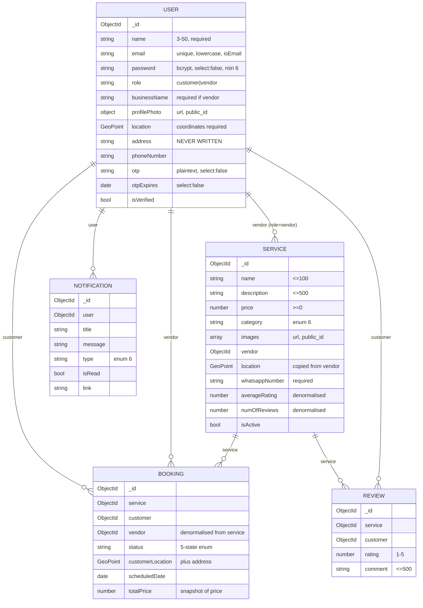
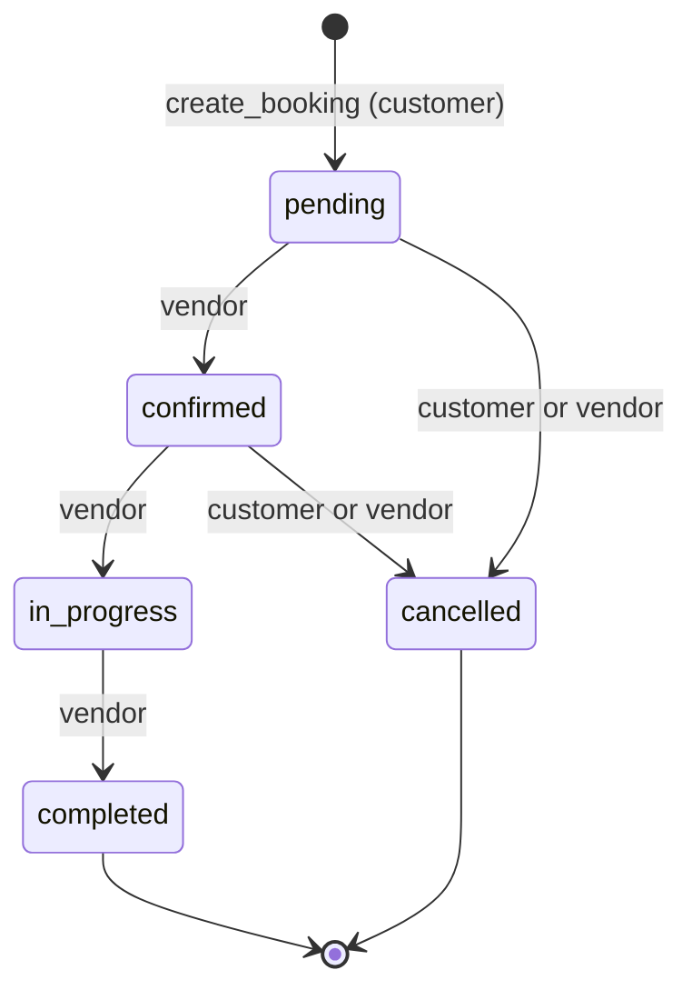
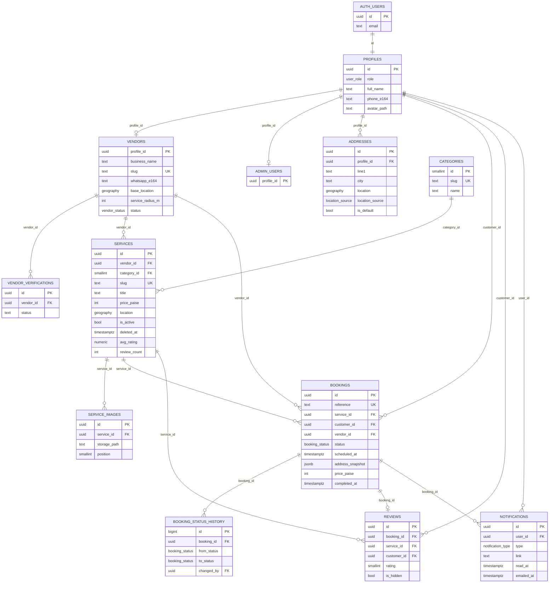

# Database Architecture

> **Document structure (revised 2026-11-17)**
> - **Part A: Current implementation (MongoDB, audited).** Unchanged from the initial audit.
> - **Part B: Proposed Supabase PostgreSQL schema.** Moving to Supabase is **Approved** (ADR-001). The schema design was **Approved** on 2026-11-17 (ADR-002 to ADR-019) and is **not yet implemented**. Updated for PD-01 (admin role required) and PD-06 (no production data).
>
> Decision status is tracked in [../planning/DECISIONS.md](../planning/DECISIONS.md). RLS policies are in [RLS_AUTHORIZATION.md](RLS_AUTHORIZATION.md), and the migration plan is in [../planning/MONGODB_TO_SUPABASE_MIGRATION.md](../planning/MONGODB_TO_SUPABASE_MIGRATION.md).

# Part A — Current implementation (MongoDB)

MongoDB through Mongoose 9.6.2. The connection is made in `Server/src/config/db.js`. No migrations, seed scripts or aggregation pipelines exist, apart from the rating `$group` (`models/Review.js:33-36`).

> This audit didn't connect to any database. Collection contents, existing data quality and whether indexes are actually built are **Requires Verification**.

## Current implementation

### Collections
| Model file | Model name | Collection (Mongoose default) | `ref` used by others |
|---|---|---|---|
| `models/User.js` | `'user'` (lowercase) | `users` | `'user'` |
| `models/Service.js` | `'Service'` | `services` | `'Service'` |
| `models/Booking.js` | `'Booking'` | `bookings` | — |
| `models/Review.js` | `'Review'` | `reviews` | — |
| `models/Notification.js` | `'Notification'` | `notifications` | — |

All schemas use `{ timestamps: true }`.

### ER diagram


### Indexes
| Collection | Index | Source | Used by |
|---|---|---|---|
| users | `email` unique | `User.js:15` | login, signup, OTP lookups |
| users | `location: 2dsphere` | `User.js:75` | **no query uses it** |
| services | `location: 2dsphere` | `Service.js:78` | `$near` in `getNearbyServices` |
| services | `{category:1, price:1}` | `Service.js:79` | could serve category filter and price sort, but the UI doesn't send those params |
| bookings | `customerLocation: 2dsphere` | `Booking.js:40` | **no query uses it** |
| bookings | `{vendor:1, status:1}` | `Booking.js:41` | `getMyBookings` (vendor), via the `vendor` prefix |
| bookings | `{customer:1}` | `Booking.js:42` | `getMyBookings` (customer) |
| bookings | `{scheduledDate:1}` | `Booking.js:43` | **no query uses it** |
| reviews | `{service:1, customer:1}` unique | `Review.js:29` | `getServiceReviews`, the duplicate check, `canReview` |
| notifications | `{user:1, isRead:1}` | `Notification.js:34` | `countDocuments`, `updateMany` |
| notifications | `{createdAt:-1}` | `Notification.js:35` | weak fit for `find({user}).sort(-createdAt)` |

### Query patterns
| Query | Location | Notes |
|---|---|---|
| `Service.find({...queryParams, isActive:true})` with skip/limit/sort and populate of vendor | `serviceController.js:180-225` | A separate `countDocuments` call. `search` becomes an unanchored, unescaped `$regex` (full scan, ReDoS) |
| `Service.find({vendor})` lean | `serviceController.js:58` | No index on `services.vendor` |
| `Service.find({$near})` | `serviceController.js:240` | No `limit`, no cap on `radius` |
| `Booking.find({vendor|customer})` with 3 populates, sorted by `-createdAt` | `bookingController.js:76-80` | No pagination. The sort isn't covered by the indexes |
| `Booking.findOne({service, customer, status:'completed'})` | `reviewController.js:12, 102` | No compound index for it |
| `Review.find({service})` with populate of customer | `reviewController.js:58` | No pagination |
| `Review.aggregate($match service, $group avg)` | `Review.js:33` | Runs after every save or delete |
| `Notification.find({user}).sort(-createdAt).limit(20)` and `countDocuments` | `notificationController.js:30-37` | Polled every 30s per open dashboard |

## Identified problems

### Data integrity
| ID | Problem | Evidence | Severity |
|---|---|---|---|
| DB-01 | `User.address` is never written. Signup sends `location.address`, which isn't in the schema, so strict mode drops it | `User.js:42-56`, `Signup.jsx:225-229` | High (BUG-02) |
| DB-02 | Geo data is corrupted by fallback coordinates. Users who deny geolocation or type an address manually are stored at Noida | `Signup.jsx:155-156,349` | High (BUG-03) |
| DB-03 | Hard-deleting a Service leaves orphaned Bookings and Reviews (dangling `service` refs) | `serviceController.js:145` | Medium |
| DB-04 | `Service.location` is a one-time copy of the vendor's location and never resyncs. Vendors can't change their location anyway | `serviceController.js:37`, `profileController.js:23` | Medium |
| DB-05 | `averageRating` and `numOfReviews` are denormalised and updated by un-awaited post hooks, so a failure leaves the counts stale with no retry | `Review.js:44-50` | Low |
| DB-06 | `Booking.vendor` duplicates `Service.vendor`. This is acceptable as a snapshot, but undocumented | `Booking.js:14` | Info |
| DB-07 | The OTP is stored in **plaintext** | `User.js:61-64` | Medium (security) |
| DB-08 | The `role` and `businessName` invariant isn't enforced for updates. A `required` function using `this.role` inside `findByIdAndUpdate` validators sees a Query, not the document (Requires Verification) | `User.js:33`, `profileController.js:32-36` | Low |
| DB-09 | `whatsappNumber` (on Service) and `phoneNumber` (on User) have no format validation. Each model has a different contact field | `Service.js:56`, `User.js:57` | Low |
| DB-10 | `Booking.customerLocation` is a snapshot of the customer's signup location, not the service address the customer intended | `bookingController.js:37-41` | Medium |
| DB-11 | Mixed model naming (`'user'` vs `'Service'`) | `User.js:77` | Low (consistency) |
| DB-12 | No `Service.vendor` index | `Service.js` | Low now; grows with data |
| DB-13 | Unused indexes cost write overhead: `users.location`, `bookings.customerLocation`, `bookings.scheduledDate` | above | Low |
| DB-14 | Notifications grow without bound. There's no TTL or archival, only a user-triggered clear | `Notification.js` | Low |
| DB-15 | `scheduledDate` isn't validated as being in the future, and there's no slot conflict check | `Booking.js:29-32` | Medium |

### Schema/query mismatches
- Bookings populate `vendor.whatsappNumber`, but the field exists only on Service (`bookingController.js:79`), causing BUG-05.

## Proposed future (not implemented; needs approval, no schema changes made)
- Add `address` (structured: line1, area, city, state, pincode) inside a `location` subdocument, plus a migration that backfills from the geocoded value where possible.
- Add `locationSource: 'gps' | 'manual' | 'default'` so fallback coordinates can be identified and the user asked to fix them.
- Soft delete for Service (`deletedAt`, or reuse `isActive` plus an `archived` flag). Block a hard delete when active bookings exist.
- Indexes:
  - `services {vendor:1, createdAt:-1}`
  - `services {isActive:1, createdAt:-1}`
  - `bookings {customer:1, createdAt:-1}`
  - `bookings {vendor:1, createdAt:-1}`
  - `notifications {user:1, createdAt:-1}`
  - A text index or Atlas Search for `services.name` and `description`
  - Drop the unused ones after verifying them in production
- Hash OTPs (sha256 + pepper), or move them to an `otp_tokens` collection with a TTL index and an attempt counter.
- Booking: add `address` (from the request, validated), `statusHistory[]`, `cancelledBy` and `cancelReason`.
- Notifications: a TTL index of about 90 days on `createdAt`.


> The "Proposed future" list above was written for MongoDB. It is **superseded by Part B**, which carries each of those fixes into the relational design.

---

# Part B — Proposed Supabase PostgreSQL schema

> **Status (2026-11-17): Phase 1 implemented locally.** The schema now exists as migrations in [`supabase/migrations/`](../../supabase/migrations/). It is tested against the local Supabase CLI stack and has **not** been applied to the staging project. The migrations are the source of truth; the DDL below is the reviewed design. Where the two differ, the differences are listed in §0.

## 0. Phase 1 implementation notes (differences from the design below)

| Area | Design below | As implemented | Why |
|---|---|---|---|
| Helper and trigger functions | `public` schema | `private` schema (`private.is_admin()`, `private.is_vendor()`, `private.owns_service()`, trigger functions) | Not exposed through the Data API, so they can't be called as RPCs |
| Public vendor fields | `public_vendor_profiles` view | **Column-level `SELECT` grant** on `vendors` (profile_id, business_name, slug, bio, logo_path, status, verified_at, created_at) plus an RLS policy that hides suspended vendors. The vendor reads their own WhatsApp number, base location and radius through `get_my_vendor()` | Avoids a security-definer view (a Security Advisor error) |
| Review author names | `public_review_authors` projection | `reviews.author_name`, a snapshot ("Asha K.") written by `create_review()` | Customer profiles never need to be readable by others |
| Admin "hide listing" (PD-13) | — | New column `services.hidden_at`. Only `admin_set_service_hidden()` writes it, and a vendor can't clear it. Public policies and search exclude hidden rows | `is_active` belongs to the vendor, so it can't double as a moderation flag |
| Vendor logo | — | New column `vendors.logo_path` (public) | The public vendor card needs an image without exposing `profiles` |
| `addresses.profile_id` | no default | `default auth.uid()` | Simpler inserts. RLS still checks the value |
| Admin RPCs | `set_vendor_status` | `admin_set_vendor_status`, `admin_set_review_hidden`, `admin_set_service_hidden`. Category writes go through admin RLS policies and are recorded by an audit trigger. Every admin action writes `admin_audit_log` | PD-13 option b |
| `search_services` | returns `cover_url` | returns `cover_path` (a Storage path; the client builds the public URL), plus `currency`, `duration_minutes`, `vendor_slug` and `vendor_status` | The database doesn't know the public Storage URL |
| `create_booking` | ≥ 1 h ahead | ≥ 1 h and ≤ 180 days ahead | Stops far-future junk bookings |
| Admin cancel | any non-terminal state | as designed, **including `in_progress`**. A reason is required | PD-13 option b |
| Privileges | Supabase defaults, then revoke | All API-role privileges are revoked, then granted per table and column. Default privileges are changed so **future tables get no API access until a migration grants it** | Default deny, also at the privilege layer |
| Deferred | — | `vendor_verifications` and the `verification-docs` bucket (PD-02); `enqueue_notification_email` (Phase 4, item 30); 90-day notification retention through `pg_cron`; the optional duplicate-booking guard | Each depends on a pending decision or on a later phase |

Migrations: `20261117000100_schema.sql`, `20261117000200_functions.sql`, `20261117000300_rls_grants.sql`, `20261117000400_storage.sql`. Tests are in `supabase/tests/database/` (92 pgTAP assertions). See [`supabase/README.md`](../../supabase/README.md).


## 1. Design principles
1. **`auth.users` is the identity source.** All application user data hangs off `public.profiles`, one row per user.
2. **Referential integrity everywhere.** Foreign keys with explicit `ON DELETE` behaviour, and check constraints for invariants.
3. **Authorization in the database.** RLS on every table in `public`. Multi-step business rules live in `SECURITY DEFINER` functions that check `auth.uid()`. Clients can't write `bookings.status` directly.
4. **Snapshots where history matters.** A booking copies the price and address at creation time.
5. **Soft delete for business records** (services). Hard delete only for personal data on account deletion.
6. **Money in integer minor units.** Timestamps are `timestamptz`. IDs are `uuid` from `gen_random_uuid()`, except for lookup tables.
7. **PostGIS** `geography(Point,4326)` for every location.

## 2. Which tables, and why

| Proposed in brief | Decision | Reason |
|---|---|---|
| Profiles | ✅ `profiles` | One row per `auth.users` row. Common fields plus the role |
| Customers | ❌ **No table** | Customers have no attributes beyond the profile today: `User.js` holds only common fields for them. An empty table would only add joins. Revisit if customer-specific data appears, such as loyalty or preferences |
| Vendors | ✅ `vendors` | Vendor-only attributes: business name, contact, verification, base location, service radius. This avoids nullable vendor columns on profiles |
| Categories | ✅ `categories` | Replaces the hardcoded enum that is duplicated in 3 places (`audit/CODEBASE_AUDIT.md`). Enables slug-based SEO URLs |
| Addresses | ✅ `addresses` | Fixes BUG-02 and BUG-03. A user can have several addresses with one default, and the table records where each location came from |
| Services | ✅ `services` | Core catalogue |
| Service images | ✅ `service_images` | Replaces the embedded array. Per-image delete and reorder fix BUG-06. |
| Bookings | ✅ `bookings` | Core transaction |
| Booking history | ✅ `booking_status_history` | Audit trail for disputes: who cancelled, and when. Written only by the transition function |
| Reviews | ✅ `reviews` | One per booking (ADR-017) |
| Notifications | ✅ `notifications` | The in-app inbox, and the source that triggers emails |
| Vendor verification | ⚠️ `vendor_verifications`, **conditional on PD-02** | Needed only if verification documents and a review step are required. For a badge-only model, the status column on `vendors` is enough |
| Admin | ✅ `admin_users` (**required**: PD-01 approved) | A separate table rather than a role value, so a profile update can never grant admin rights |
| — | ~~`migration.legacy_id_map`~~ | **Not needed**: there is no production data to migrate (PD-06) |

## 3. Enumerated types

```sql
create type public.user_role         as enum ('customer', 'vendor');
create type public.vendor_status     as enum ('unverified', 'pending', 'verified', 'suspended');
create type public.booking_status    as enum ('pending', 'confirmed', 'in_progress', 'completed', 'cancelled');
create type public.location_source   as enum ('gps', 'geocoded', 'manual_unverified');
create type public.notification_type as enum ('booking_new', 'booking_confirmed', 'booking_cancelled',
                                              'booking_in_progress', 'booking_completed', 'review_new');
```

- Mongo's `in-progress` becomes `in_progress`. The ETL maps it.
- The earlier draft's `legacy_default` value was removed, because there is no migrated data (PD-06).

## 4. Tables

### 4.1 `profiles`
| Column | Type | Constraints |
|---|---|---|
| `id` | uuid | **PK**, FK → `auth.users(id)` **on delete cascade** |
| `role` | `user_role` | not null, default `'customer'`. **Users can't update it**: the column privilege is revoked and a trigger guards it |
| `full_name` | text | not null, `check (char_length(full_name) between 2 and 80)` |
| `phone_e164` | text | null, `check (phone_e164 ~ '^\+[1-9][0-9]{7,14}$')` |
| `avatar_path` | text | null. A Storage object path in the `avatars` bucket |
| `created_at`, `updated_at` | timestamptz | not null, default `now()`. `updated_at` is maintained by a trigger |

- Email is **not duplicated**. It lives in `auth.users.email`, and a counterparty can see it only through `get_booking_contact()` (RLS doc §5).
- Indexes: PK only.

### 4.2 `vendors`
| Column | Type | Constraints |
|---|---|---|
| `profile_id` | uuid | **PK**, FK → `profiles(id)` on delete cascade |
| `business_name` | text | not null, `check (char_length(business_name) between 2 and 100)` |
| `slug` | text | not null, **unique**. Used for the public vendor URL |
| `whatsapp_e164` | text | null, same E.164 check. Gives the number one canonical home, which fixes BUG-05 |
| `bio` | text | null, `check (char_length(bio) <= 1000)` |
| `base_location` | geography(Point,4326) | null |
| `service_radius_m` | integer | not null, default 10000, `check (service_radius_m between 500 and 100000)` |
| `status` | `vendor_status` | not null, default `'unverified'`. Writable **only by an admin or the service role** |
| `verified_at` | timestamptz | null |
| `created_at`, `updated_at` | timestamptz | |

- The signup trigger creates the row when `role = 'vendor'`.
- A trigger checks that the referenced profile has `role = 'vendor'`. A CHECK constraint can't look across tables, so it has to be a trigger.
- Indexes: `unique(slug)`, `gist(base_location)`.
- Public fields are exposed through a **column-level SELECT grant** (§0): business_name, slug, bio, logo_path, status and verified_at. Contact and location fields stay out of it and are read by the owner through `get_my_vendor()`.

### 4.3 `vendor_verifications` *(conditional on PD-02)*
| Column | Type | Constraints |
|---|---|---|
| `id` | uuid | PK |
| `vendor_id` | uuid | FK → `vendors(profile_id)` on delete cascade |
| `document_paths` | text[] | not null. Objects in the private `verification-docs` bucket |
| `status` | text | `check (status in ('submitted','approved','rejected'))` |
| `reviewer_id` | uuid | FK → `profiles(id)` on delete set null |
| `reviewer_notes` | text | null |
| `submitted_at`, `reviewed_at` | timestamptz | |

- Index on `(vendor_id, submitted_at desc)`.
- A partial unique index `(vendor_id) where status = 'submitted'` allows only one open submission per vendor.

### 4.4 `categories`
| Column | Type | Constraints |
|---|---|---|
| `id` | smallint | PK, generated always as identity |
| `slug` | text | **unique**, `check (slug ~ '^[a-z0-9-]+$')` |
| `name` | text | not null, unique |
| `icon` | text | null. A lucide icon name |
| `sort_order` | smallint | not null, default 0 |
| `is_active` | boolean | not null, default true |

- Seeded with the current six categories: cleaning, repair, salon, electrician, plumber, cooking.
- Anyone can read. Only admins can write.

### 4.5 `addresses`
| Column | Type | Constraints |
|---|---|---|
| `id` | uuid | PK |
| `profile_id` | uuid | FK → `profiles(id)` **on delete cascade** |
| `label` | text | null, e.g. "Home" or "Office" |
| `line1` | text | not null |
| `line2` | text | null |
| `area` | text | not null |
| `city` | text | not null |
| `state` | text | not null |
| `postal_code` | text | null, `check (postal_code ~ '^[0-9]{6}$')`. Indian PIN format (PD-08) |
| `country_code` | char(2) | not null, default `'IN'` |
| `location` | geography(Point,4326) | null. A manual address may not be geocoded yet |
| `location_source` | `location_source` | not null |
| `is_default` | boolean | not null, default false |
| `created_at`, `updated_at` | timestamptz | |

- Indexes: `(profile_id)`, **partial unique** `(profile_id) where is_default` so each user has at most one default, and `gist(location)`.
- Fixes BUG-02 (the address is now persisted) and BUG-03 (no silent default, because the source is recorded).

### 4.6 `services`
| Column | Type | Constraints |
|---|---|---|
| `id` | uuid | PK |
| `vendor_id` | uuid | FK → `vendors(profile_id)` **on delete restrict** |
| `category_id` | smallint | FK → `categories(id)` on delete restrict |
| `slug` | text | not null, **unique**. SEO URL `/services/{slug}` |
| `title` | text | not null, `check (char_length(title) between 3 and 100)` |
| `description` | text | not null, `check (char_length(description) between 10 and 2000)` |
| `price_paise` | integer | not null, `check (price_paise >= 0)` |
| `currency` | char(3) | not null, default `'INR'` |
| `duration_minutes` | integer | null, `check (duration_minutes between 15 and 1440)`. Replaces the hardcoded "Avg. 2 Hours" (UX-04) |
| `location` | geography(Point,4326) | not null. Defaults to the vendor's base location and the vendor can edit it, which fixes DB-04 |
| `is_active` | boolean | not null, default true. The vendor's pause toggle |
| `deleted_at` | timestamptz | null. Soft delete (ADR-018) |
| `avg_rating` | numeric(2,1) | not null, default 0, `check (avg_rating between 0 and 5)`. **Maintained only by a trigger** |
| `review_count` | integer | not null, default 0, `check (review_count >= 0)`. Trigger only |
| `search_tsv` | tsvector | `generated always as (setweight(to_tsvector('simple', title),'A') ‖ setweight(to_tsvector('simple', description),'B')) stored` (‖ is the SQL `||` operator) |
| `created_at`, `updated_at` | timestamptz | |

- Indexes:
  - `gist(location)` for nearby search.
  - `gin(search_tsv)` for full-text search, replacing the unescaped `$regex` (SEC-03, PERF-04).
  - `(category_id, price_paise) where is_active and deleted_at is null`.
  - `(vendor_id, created_at desc)` for the vendor dashboard (PERF-06).
  - `(created_at desc) where is_active and deleted_at is null` for the default Explore sort.
- The `'simple'` text-search configuration is used because the content is likely mixed English and Hindi. Requires Verification against real data; `pg_trgm` is an option.
- Column privileges: clients may write only `category_id`, `title`, `description`, `price_paise`, `duration_minutes`, `location`, `is_active` and `slug`. They can't write `avg_rating`, `review_count`, `deleted_at`, or `vendor_id` after insert. This fixes SEC-04. Soft delete goes through an RPC.

### 4.7 `service_images`
| Column | Type | Constraints |
|---|---|---|
| `id` | uuid | PK |
| `service_id` | uuid | FK → `services(id)` **on delete cascade** |
| `storage_path` | text | **not null**. Bucket `service-images`, path `{vendor_id}/{service_id}/{uuid}.webp` |
| `alt_text` | text | null |
| `position` | smallint | not null, `check (position between 0 and 3)`. Keeps today's limit of 4 images |
| `created_at` | timestamptz | |

- Supabase Storage only. The Cloudinary provider columns from the earlier draft were removed, because there are no legacy images (PD-06; PD-07 moot).
- `unique (service_id, position)`, deferrable, so images can be reordered inside one transaction.

### 4.8 `bookings`
| Column | Type | Constraints |
|---|---|---|
| `id` | uuid | PK |
| `reference` | text | not null, unique. A human-readable code such as `VNY-7K3Q9P` |
| `service_id` | uuid | FK → `services(id)` **on delete restrict** |
| `customer_id` | uuid | FK → `profiles(id)` **on delete restrict** (see §6) |
| `vendor_id` | uuid | FK → `vendors(profile_id)` **on delete restrict**. Copied from the service and **set by the function, never by the client** |
| `status` | `booking_status` | not null, default `'pending'` |
| `scheduled_at` | timestamptz | not null |
| `customer_notes` | text | null, `check (char_length(customer_notes) <= 1000)` |
| `address_snapshot` | jsonb | not null. A copy of the chosen address (line1 through postal_code), so later address edits don't rewrite history |
| `address_location` | geography(Point,4326) | null |
| `price_paise` | integer | not null, `check (price_paise >= 0)`. Snapshot of the service price |
| `currency` | char(3) | not null |
| `cancelled_by` | uuid | FK → `profiles(id)`, null |
| `cancel_reason` | text | null |
| `confirmed_at`, `started_at`, `completed_at`, `cancelled_at` | timestamptz | null. Set by the transition function. `completed_at` fixes BE-08 |
| `created_at`, `updated_at` | timestamptz | |

- Check constraints:
  - `customer_id <> vendor_id`, so nobody can book themselves.
  - `(status = 'cancelled') = (cancelled_at is not null)`.
  - `(status = 'completed') = (completed_at is not null)`.
  - `scheduled_at > created_at`, so no bookings in the past (DB-15).
- Indexes: `(customer_id, created_at desc)`, `(vendor_id, status, scheduled_at)` for the vendor inbox, `(vendor_id, created_at desc)`, `(service_id)`.
- Optional duplicate guard (pending product confirmation): partial unique `(customer_id, service_id, scheduled_at) where status in ('pending','confirmed')`.
- **Clients get no direct INSERT or UPDATE.** All writes go through `create_booking()` and `transition_booking()` (§5).

### 4.9 `booking_status_history`
| Column | Type | Constraints |
|---|---|---|
| `id` | bigint | PK, identity |
| `booking_id` | uuid | FK → `bookings(id)` **on delete cascade** |
| `from_status` | `booking_status` | null on creation |
| `to_status` | `booking_status` | not null |
| `changed_by` | uuid | FK → `profiles(id)` on delete set null |
| `reason` | text | null |
| `created_at` | timestamptz | not null, default `now()` |

- Index on `(booking_id, created_at)`.
- Insert-only, and written only by the functions. There are no update or delete policies.

### 4.10 `reviews`
| Column | Type | Constraints |
|---|---|---|
| `id` | uuid | PK |
| `booking_id` | uuid | FK → `bookings(id)` **on delete restrict**, **unique** (ADR-017) |
| `service_id` | uuid | FK → `services(id)` on delete restrict. Set by the function |
| `customer_id` | uuid | FK → `profiles(id)` on delete restrict. Set by the function |
| `rating` | smallint | not null, `check (rating between 1 and 5)` |
| `comment` | text | null, `check (char_length(comment) <= 500)` |
| `vendor_reply` | text | null, `check (char_length(vendor_reply) <= 500)`. Reserved for a future feature |
| `is_hidden` | boolean | not null, default false. Set by admins for moderation |
| `created_at`, `updated_at` | timestamptz | |

- Indexes: `unique(booking_id)`, `(service_id, created_at desc) where not is_hidden`, `(customer_id)`.
- **Eligibility** is checked in `create_review()`. The booking must belong to `auth.uid()` as its customer, its `status` must be `'completed'`, and it must not already have a review.
- After insert, update or delete, a trigger recalculates `services.avg_rating` and `review_count`, excluding hidden reviews. It runs **in the same transaction**, which fixes DB-05.

> **Behaviour change vs today:** Mongo enforced one review per (service, customer) (`models/Review.js:29`). This proposal allows one per *booking*. If the product owner prefers the current rule, use `unique(service_id, customer_id)` and keep `booking_id` as the proof reference.

### 4.11 `notifications`
| Column | Type | Constraints |
|---|---|---|
| `id` | uuid | PK |
| `user_id` | uuid | FK → `profiles(id)` **on delete cascade** |
| `type` | `notification_type` | not null |
| `title` | text | not null, `check (char_length(title) <= 120)` |
| `body` | text | not null, `check (char_length(body) <= 1000)` |
| `link` | text | null, `check (link ~ '^/[^/]')`. Internal paths only, so it can't be used as an open redirect |
| `booking_id` | uuid | FK → `bookings(id)` on delete cascade, null |
| `read_at` | timestamptz | null |
| `emailed_at` | timestamptz | null. Set by the email Edge Function so it never sends the same email twice |
| `created_at` | timestamptz | |

- Indexes: `(user_id, created_at desc)`, and a partial index `(user_id) where read_at is null` for the unread count.
- Rows are **inserted only by functions or triggers**. A client can only set `read_at` on its own rows (fixes SEC-09) and delete its own rows.
- Retention: a `pg_cron` job deletes rows older than 90 days (pending).

### 4.12 `admin_users` (required: PD-01 approved; powers per PD-13 option b)
| Column | Type | Constraints |
|---|---|---|
| `profile_id` | uuid | PK, FK → `profiles(id)` on delete cascade |
| `granted_by` | uuid | FK → `profiles(id)`, null |
| `granted_at` | timestamptz | not null, default now() |

- RLS is enabled with **no policies for authenticated users**. Only the service role or a SQL migration can write to it.
- Helper: `public.is_admin()` (SECURITY DEFINER, `stable`) returns whether `auth.uid()` is present in `admin_users`.

## 5. Database functions & triggers

Rules for every `SECURITY DEFINER` function:
- `set search_path = ''`, with fully qualified names.
- An explicit `auth.uid()` check.
- `EXECUTE` revoked from `public` and `anon`, and granted to `authenticated` only.

| Function / trigger | Type | Purpose |
|---|---|---|
| `handle_new_user()` | trigger after insert on `auth.users` | Creates the `profiles` row from `raw_user_meta_data` (full_name and role). Only `customer` and `vendor` are accepted; **anything else falls back to customer**. Creates the `vendors` row for a vendor. **It can never create an admin.** |
| `guard_profile_role()` | trigger before update on `profiles` | Raises an error if `new.role <> old.role` and the caller isn't the service role. This is a second layer behind the column privilege |
| `set_updated_at()` | trigger | Maintains `updated_at` |
| `create_booking(p_service_id uuid, p_scheduled_at timestamptz, p_address_id uuid, p_notes text) returns bookings` | RPC, SECURITY DEFINER | One transaction. Checks that the service is active and not deleted, the caller isn't its vendor, the address belongs to the caller, `p_scheduled_at > now() + interval '1 hour'` (configurable), and the vendor isn't suspended. Then snapshots the price and address, inserts the booking and its history row, and creates the vendor's `booking_new` notification. Fixes BUG-02, BE-03, DB-10 and DB-15 |
| `transition_booking(p_booking_id uuid, p_to booking_status, p_reason text default null) returns bookings` | RPC, SECURITY DEFINER | Locks the row with `select … for update` and applies the **transition table below**. Sets the timestamp columns, writes the history row and notifies the other party |
| `create_review(p_booking_id uuid, p_rating int, p_comment text) returns reviews` | RPC, SECURITY DEFINER | Checks eligibility. Takes `service_id` and `customer_id` from the booking, never from the client. Inserts the review, which fires the rating trigger, then creates the vendor's `review_new` notification (BE-06) |
| `recalc_service_rating()` | trigger on `reviews` | Recalculates `avg_rating` and `review_count`, excluding hidden reviews |
| `search_services(p_q text, p_category text, p_min_paise int, p_max_paise int, p_lng float8, p_lat float8, p_radius_m int, p_sort text, p_limit int, p_offset int)` | RPC, SECURITY INVOKER, so RLS applies | One validated search entry point. Clamps `p_limit` to ≤ 50 and `p_radius_m` to ≤ 50,000. Uses `websearch_to_tsquery` and a whitelisted `p_sort`. When `p_lng` and `p_lat` are given, it filters with `ST_DWithin` and orders by distance. Fixes SEC-03, BUG-04 and F-02 |
| `soft_delete_service(p_service_id uuid)` | RPC, SECURITY DEFINER | Owner only. Sets `deleted_at` and `is_active = false` |
| `get_booking_contact(p_booking_id uuid)` | RPC, SECURITY DEFINER | Returns the other party's name, phone, WhatsApp number and email **only** to a participant, and only while the booking status is `confirmed` or `in_progress`. PII stays private outside active jobs |
| `mark_notifications_read(p_ids uuid[] default null)` | RPC, SECURITY INVOKER | Marks the caller's notifications as read: all of them, or only the given IDs |
| `enqueue_notification_email()` | trigger after insert on `notifications` | Sends work to the `send-notification-email` Edge Function, through a Database Webhook, `pg_net`, or a `pgmq` queue (preferred, because it retries). The mechanism is chosen during implementation |
| `generate_slug()` | trigger | Builds slugs for services and vendors, adding a suffix when needed for uniqueness |

### Booking status transitions (enforced in `transition_booking`)

| From → To | Customer | Vendor | Side effects |
|---|---|---|---|
| pending → confirmed | ❌ | ✅ | Sets `confirmed_at`, notifies the customer |
| pending → cancelled | ✅ | ✅ (reason required) | Sets `cancelled_at` and `cancelled_by`, notifies the other party |
| confirmed → in_progress | ❌ | ✅ | Sets `started_at`, notifies the customer |
| confirmed → cancelled | ✅ | ✅ (reason required) | Same as above |
| in_progress → completed | ❌ | ✅ | Sets `completed_at`, notifies the customer and invites a review |
| anything else | ❌ | ❌ | Raises `invalid_transition` |

This preserves today's state machine exactly (`bookingController.js:118-143`). Admins (PD-01: approved) may cancel from any non-terminal state (included in PD-13 option b), with a required reason, recorded in `booking_status_history` and `admin_audit_log`.



## 6. Deletion & referential integrity

| Event | Behaviour |
|---|---|
| User deletes their account | Deleting the auth user would cascade to `profiles`, but the bookings FK (`restrict`) **blocks it** while bookings exist. Instead, an account-deletion Edge Function **anonymises** the profile: the name becomes "Deleted user" and the phone and avatar are cleared. It deletes the auth user only once every booking is in a terminal state. *The exact policy needs a privacy/legal decision (pending).* |
| Vendor deletes a service | Soft delete via `soft_delete_service()`. The service disappears from search, and bookings and reviews keep their references |
| Hard delete of a service | Blocked by `restrict` on `bookings.service_id` and `reviews.service_id`. Images cascade. Storage objects are cleaned up by an Edge Function or cron job |
| Address deleted | Allowed. Bookings keep their `address_snapshot` |
| Booking deleted | Not allowed for clients; admin or service role only. Status history cascades; reviews `restrict` the delete |

## 7. ER diagram (proposed)



`ADMIN_USERS` is required (PD-01 approved). `VENDOR_VERIFICATIONS` depends on PD-02.

## 8. Mongo → Postgres field mapping (reference only)

> **Not used:** there is no production data (PD-06), so nothing will be migrated. This mapping is kept only as a record of how the old model maps to the new one.

The full procedure is in [../planning/MONGODB_TO_SUPABASE_MIGRATION.md](../planning/MONGODB_TO_SUPABASE_MIGRATION.md).

| Mongo | Postgres |
|---|---|
| `user` (customer) | `auth.users` + `profiles` |
| `user` (vendor) | `auth.users` + `profiles` + `vendors` |
| `user.password` (bcrypt) | `auth.users.encrypted_password`, if hash import is supported (Requires Verification) |
| `user.otp`, `otpExpires` | **Dropped.** Supabase Auth handles verification |
| `user.isVerified` | `auth.users.email_confirmed_at`, **reset to null** under PD-05 |
| `user.location` | An `addresses` row. `location_source` is `legacy_default` if the value equals the Noida fallback `[77.391, 28.5355]`, otherwise `gps` (unconfirmed). `line1` is a placeholder and the user is asked to complete the address |
| `user.address` | Never populated because of BUG-02, so there is nothing to migrate |
| `user.profilePhoto` | `profiles.avatar_path` after the image copy, or an external URL until then (PD-07) |
| `service.category` (enum) | `services.category_id` → `categories` |
| `service.price` (rupees) | `price_paise = round(price * 100)` |
| `service.images[]` | `service_images` rows with `provider = 'cloudinary'` |
| `service.whatsappNumber` | `vendors.whatsapp_e164`, normalised. If a vendor's services have different numbers, they are reported for a manual decision |
| `service.averageRating`, `numOfReviews` | **Recomputed** from the migrated reviews, not copied |
| `booking.customerLocation` | `address_location`. `address_snapshot` becomes `{"legacy": true, "text": "<old address or Home>"}` |
| `booking.status` `in-progress` | `in_progress` |
| `review` (service, customer) | `reviews.booking_id` = that pair's latest completed booking. If none exists, the review goes to quarantine |
| `notification` | Skipped, or only the last 90 days migrated (PD-10) |
