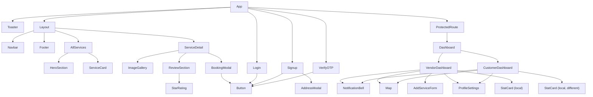

# Frontend Architecture

> **Document structure (revised 2026-11-17)**
> - **Part A: Current implementation (MERN, audited).** Unchanged from the initial audit.
> - **Part C: Current target (2026-11-18): React + Vite SPA** (ADR-020). See the end of this file. **Part B (Next.js) is superseded** and kept for reference only.
> - **Part B: Target frontend (Next.js App Router + TypeScript). SUPERSEDED by ADR-020.** Supabase PostgreSQL is **Approved** (ADR-001). The rest of Part B was **Approved** on 2026-11-17 (ADR-002 to ADR-019).
>
> Decision status is tracked in [../planning/DECISIONS.md](../planning/DECISIONS.md).

# Part A — Current implementation (MERN)


`Client/veny-frontend/`. React 19.2.5, Vite 8.0.10, JavaScript (JSX), Tailwind CSS 4.2.4 via `@tailwindcss/postcss`.

## Current implementation

### Folder structure
```
src/
├── main.jsx                 # createRoot + StrictMode, imports index.css + leaflet.css
├── App.jsx                  # BrowserRouter, Toaster, all routes, inline Layout
├── App.css                  # EMPTY, not imported anywhere
├── index.css                # Tailwind v4 @theme tokens, keyframes, base body, autofill fix
├── api/axiosClient.js       # axios instance + auth/401 interceptors
├── services/                # authService, bookingService, serviceService
├── components/              # 10 components (mixed: primitives + feature widgets)
├── pages/                   # 8 pages (incl. 2 large dashboards)
└── assets/                  # hero.png, react.svg, vite.svg: none referenced
```
The structure is organised by technical type (pages, components, services), not by feature.

### Route map (`src/App.jsx`)
| Path | Element | Layout | Guard |
|---|---|---|---|
| `/` | `Navigate → /explore` | — | — |
| `/login` | `Login` | none | — |
| `/signup` | `Signup` | none | — |
| `/verify-otp` | `VerifyOTP` | none | Needs `location.state.email` |
| `/dashboard` | `Dashboard` → `VendorDashboard` or `CustomerDashboard` | **own sidebar layout** | `ProtectedRoute` (token expiry only) |
| `/explore` | `AllServices` | `Layout` (Navbar + Footer) | — |
| `/service/:id` | `ServiceDetail` | `Layout` | — |
| `/unauthorized` | inline JSX | `Layout` | — |
| `*` | `Navigate → /explore` | — | — |

Dashboard sections are **not routes**. They are switched with `useState('Overview')` (`VendorDashboard.jsx:30`, `CustomerDashboard.jsx:29`). As a result, refreshing always lands on Overview, sections can't be deep-linked, and the browser Back button leaves the dashboard.

### Component tree


### Component inventory
| File | Lines | Role | Notes |
|---|---|---|---|
| `pages/VendorDashboard.jsx` | 414 | Page and layout, 4 sections | Too large. It owns fetching, the sidebar, the header and every section |
| `pages/CustomerDashboard.jsx` | 411 | Page and layout, 3 sections | Duplicates the sidebar, header, `StatCard` and `STATUS_STYLES` from VendorDashboard |
| `pages/Signup.jsx` | 403 | Page with an inline `AddressModal` | Geolocation, geocoding, validation and EmailJS all in one component |
| `components/AddServiceForm.jsx` | 302 | Create/edit form | Image state is split across 3 arrays |
| `components/ReviewSection.jsx` | 270 | Widget | Calls axios directly |
| `pages/ServiceDetail.jsx` | 250 | Page | Inline `ImageGallery` |
| `components/ProfileSettings.jsx` | 238 | Form | Calls axios directly and writes localStorage |
| `pages/AllServices.jsx` | 225 | Page | Inline `HeroSection` and `ServiceCard` |
| `components/NotificationBell.jsx` | 201 | Widget | Polls every 30s and calls axios directly |
| `pages/Login.jsx` | 168 | Page | |
| `pages/VerifyOTP.jsx` | 141 | Page | |
| `components/BookingModal.jsx` | 126 | Modal | Reads `user` from localStorage |
| `components/Navbar.jsx` | 89 | Public header | Static links, not aware of auth state |
| `components/ProtectedRoute.jsx` | 88 | Guard | `requiredRole` is never used |
| `components/Footer.jsx` | 83 | Public footer | All links are `#` |
| `components/Map.jsx` | 71 | Leaflet wrapper | The component name shadows the global `Map` |
| `components/Button.jsx` | 37 | Primitive | Doesn't forward `className`, although callers pass one (`Login.jsx:144`) |
| `pages/Dashboard.jsx` | 23 | Role switch | Spins forever if `user` is missing |

### State management
- **Local `useState` only.** There is no Context, Redux store or query cache.
- `@reduxjs/toolkit` and `react-redux` are installed but **never imported** (verified with grep).
- **Auth and user state live in `localStorage`** (`token`, `user`). They are read directly in 7+ places: `axiosClient`, `ProtectedRoute`, `Dashboard`, `BookingModal`, `ReviewSection`, `NotificationBell` and `ProfileSettings`. Nothing reacts when they change. For example, `NotificationBell` reads the token once per render.
- Server data is fetched in `useEffect` without cancellation. The `react-hooks/exhaustive-deps` lint rule would likely flag `ReviewSection.jsx:54-57` and `NotificationBell.jsx:37-42` (Requires Verification: lint was not run).

### API layer
- `api/axiosClient.js` sets the base URL from `VITE_API_BASE_URL`, attaches a Bearer token, and on a 401 does `localStorage.clear()` followed by `window.location.href = '/login'`.
  - The 401 handler fires on **any** 401, including the wrong-password case. Login returns 400, so login is safe, but the pattern is fragile.
  - It does a full page reload and loses the "return to" path.
- Service modules (`services/*.js`) exist, but **half the components bypass them**. `ReviewSection`, `NotificationBell`, `ProfileSettings`, `AddServiceForm` and `VendorDashboard` call `axiosClient` directly.
- The service modules return different shapes:
  - `serviceService` returns `response.data`, except `getServiceById`, which returns `response.data.data`.
  - `bookingService` and `authService` return the raw axios response.
- `serviceService` wraps each call in `try { … } catch (e) { throw e }`, which is a no-op (`serviceService.js:11-16`, among others).

### Forms & validation
- Forms are controlled inputs with manual `if` checks (`Signup.jsx:213-217`, `AddServiceForm.jsx:77-84`, `ReviewSection.jsx:79-80`).
- There is no schema library, and there are no per-field error messages. Each form shows a single error string or a toast.
- Server error messages are read as `err.response?.data?.message || err.response?.data?.msg`, because the backend is inconsistent.

### Loading / error / empty states
- Loading spinners exist for Explore, detail, dashboard bookings and reviews.
- Errors are often swallowed with `catch { /* silent */ }` (`NotificationBell.jsx:33`, `ReviewSection.jsx:63,72`). `ServiceDetail` logs errors and then shows "not found" for **any** error, network failures included (`ServiceDetail.jsx:94-96`).
- Empty states exist for services, bookings, reviews and notifications.
- There are no React error boundaries.

### Styling
- Tailwind v4 with a `@theme` block in `index.css` defining `--color-veny-*` tokens and 3 animations.
- The tokens are used only partially: raw hex values appear in JSX 25 times (for example `#020617` ×16, `#0a0f1e`, `#0A0A0A`, `#0f172a`).
- Classes such as `animate-in`, `fade-in`, `zoom-in-95`, `slide-in-from-top-2` and `animation-delay-2000` are used (39 occurrences) but **are not defined**. No `tailwindcss-animate` or `tw-animate-css` plugin is installed, so those animations are no-ops (confirmed statically).
- See [../design/UI_UX_AUDIT.md](../design/UI_UX_AUDIT.md).

### Build configuration
- `vite.config.js` has `dedupe` and `optimizeDeps` for react-leaflet and leaflet, added to work around an earlier "Invalid hook call".
- `eslint.config.js` uses the flat config with js recommended, react-hooks and react-refresh. There is no Prettier.
- There is no code splitting: every page is imported eagerly in `App.jsx:4-12`.

## Identified problems
Indexed in [../audit/BUGS_AND_ISSUES.md](../audit/BUGS_AND_ISSUES.md):
- FE-01: duplicate dashboard shells.
- FE-02: localStorage as the state store.
- FE-03: inconsistent API layer.
- FE-04: dashboard sections aren't routes.
- FE-05: `Button` ignores `className`.
- FE-06: undefined animation classes.
- FE-07: no error boundary.
- FE-08: unused Redux.
- BUG-04 and BUG-05 (above).

## Proposed future (not implemented)
```
src/
├── app/            # providers (QueryClient, Router, Auth), routes, layouts
├── components/ui/  # design-system primitives (Button, Input, Modal, Card, Badge, Table, …)
├── features/
│   ├── auth/       # pages, hooks (useAuth), api, schemas
│   ├── services/   # explore, detail, vendor listing CRUD
│   ├── bookings/
│   ├── reviews/
│   ├── notifications/
│   └── profile/
├── lib/            # apiClient, formatters (currency, date), constants (categories, statuses)
└── styles/         # tokens
```
- Nested routes for the dashboard: `/dashboard/services`, `/dashboard/bookings`, `/dashboard/settings`, with one shared `DashboardLayout`.
- An `AuthProvider` that fetches `/me` on load instead of trusting localStorage.
- TanStack Query for server state, and React Hook Form with Zod for forms.
- `React.lazy` for the dashboards and for map and chart chunks.


---

# Part B — Target frontend: Next.js App Router + TypeScript (Recommended, ADR-002/004/010–013)

> **Status:** **Approved** (ADR-002/004/010–013, 2026-11-17). The "Proposed future" Vite folder layout above is **superseded**. Nothing has been implemented yet. Exact framework versions are chosen at implementation time: latest stable Next.js, `@supabase/ssr` and shadcn/ui. Their APIs are Requires Verification at that point.

## B1. Why Next.js for Veny
| Need | Vite SPA (today) | Next.js App Router |
|---|---|---|
| Google-indexable service and category pages with rich previews | Client-rendered. Crawlers get an empty `#root`. `<title>` is `veny-frontend` | SSR / ISR HTML, `generateMetadata`, JSON-LD (`Service`, `AggregateRating`), `sitemap.ts` |
| Secure session | Token in localStorage (SEC-06) | httpOnly cookies through `@supabase/ssr` and middleware |
| Server-side validation without a separate API | Needs Express | Server Actions + Zod |
| Image optimisation | None | `next/image` with the Supabase Storage remote pattern |
| Code splitting | None (PERF-07) | Automatic per route |

**Disadvantages:**
- Concepts are harder: the server/client boundary and caching.
- It is a full rewrite.
- Vercel is the best-supported host. Others are possible.
- Server Actions need care: each one is a public endpoint, so it has to validate input and authenticate on every call.

## B2. Route structure
```
app/
├── (public)/                       # PublicLayout: auth-aware header, footer
│   ├── page.tsx                    # Home: hero, categories, featured services
│   ├── services/page.tsx           # Explore: search/filter/near-me (searchParams → search_services RPC)
│   ├── services/[slug]/page.tsx    # Service detail — SSR/ISR, metadata, JSON-LD, reviews
│   ├── categories/[slug]/page.tsx  # Category landing — SEO
│   └── vendors/[slug]/page.tsx     # Public vendor profile
├── (auth)/
│   ├── sign-in/page.tsx
│   ├── sign-up/page.tsx            # ?role=vendor supported (fixes UX-01)
│   ├── check-email/page.tsx
│   ├── reset-password/page.tsx
│   └── auth/confirm/route.ts       # email confirmation / OTP verify handler
├── (dashboard)/dashboard/          # DashboardLayout: server guard (getUser + profile.role)
│   ├── page.tsx                    # redirects to role home
│   ├── customer/{page,bookings,bookings/[id],addresses,settings}
│   ├── vendor/{page,bookings,bookings/[id],services,services/new,services/[id]/edit,profile,settings}
│   └── admin/...                   # admin console (PD-01: approved)
├── sitemap.ts, robots.ts
├── not-found.tsx, error.tsx, global-error.tsx   # fixes FE-07, FE-18
└── middleware.ts                   # session refresh; redirect unauthenticated /dashboard/*
```

- Each dashboard section is its own URL. This fixes FE-04.
- One `DashboardShell` (sidebar, plus mobile bottom tabs) is shared by both roles, with a role-specific nav config. This fixes FE-01.

## B3. Feature-based source layout
```
src/
├── app/                      # routes only (thin)
├── components/ui/            # shadcn/ui primitives (Button, Input, Dialog, Sheet, Badge, Card, Table…) themed via DESIGN_SYSTEM tokens
├── components/layout/        # PublicHeader, Footer, DashboardShell
├── features/
│   ├── auth/                 # actions.ts, schemas.ts, components/
│   ├── services/             # queries.ts (server), actions.ts, schemas.ts, components/ (ServiceCard, ServiceForm, ImageManager)
│   ├── bookings/             # BookingForm, StatusBadge, StatusTimeline, actions (create/transition)
│   ├── reviews/
│   ├── notifications/        # client: useNotifications (TanStack Query + Realtime)
│   ├── addresses/            # AddressForm with geocoding action
│   └── profile/
├── lib/
│   ├── supabase/{server.ts, client.ts, middleware.ts, admin.ts (server-only)}
│   ├── database.types.ts     # generated: supabase gen types typescript
│   ├── errors.ts             # Postgres/PostgREST → ActionResult
│   ├── money.ts, dates.ts, phone.ts
│   └── constants.ts
└── styles/globals.css        # Tailwind v4 @theme tokens
```

## B4. Data-fetching rules
| Case | Mechanism |
|---|---|
| Public pages | Server Component + Supabase server client (anon). `revalidate` or tag-based revalidation when a vendor edits a service |
| Authenticated pages | Server Component, dynamic (`cookies()`), **never statically cached** |
| Mutations | Server Action → Zod → Supabase (RLS) or RPC → `revalidatePath` / `revalidateTag` → returns `ActionResult` |
| Interactive client lists (vendor inbox, notifications, Explore "load more") | TanStack Query with the **browser** Supabase client (RLS applies). Hydrated from server data. Realtime events invalidate queries |
| Forms | React Hook Form + `zodResolver`. **The same Zod schema** is re-validated in the Server Action |

**Is TanStack Query necessary?** Not for most pages; Server Components and Server Actions cover them. It earns its place where you need client-side caching, optimistic updates, Realtime-driven invalidation and infinite scrolling. Adopt it **only in those islands** (ADR-012). The alternative is plain `useState`/`useEffect` with `router.refresh()`, which is simpler but loses optimistic UI and deduplication.

## B5. Authentication in the UI
- `middleware.ts` refreshes the session cookie and redirects unauthenticated `/dashboard/*` requests to `/sign-in?next=…`.
- `DashboardLayout` (server) calls `getUser()`, loads `profiles.role` and redirects to the matching role area. A wrong-role URL gets a 404 or redirect, which makes the `/unauthorized` route unnecessary.
- The header is auth-aware (fixes UX-01). A guest who tries to book is sent to sign-in with `next` and comes back to the booking (UX-06).
- No auth state in localStorage (fixes FE-02).
- Password-manager friendly `autocomplete` attributes (fixes UX-05).

## B6. SEO for public service pages
- Slug URLs: `/services/{service-slug}`, `/categories/{category-slug}`, `/vendors/{vendor-slug}`.
- `generateMetadata` builds the title, description, canonical URL and Open Graph image (the first service image).
- JSON-LD: `Service`, with `provider` (`LocalBusiness`), `areaServed`, `offers.price`/`priceCurrency` and `aggregateRating` **only when reviews exist** (avoids UX-04-style false claims).
- `sitemap.ts` generated from active services, categories and vendors. `robots.ts` disallows `/dashboard`.
- Rendering: ISR (a time-based revalidate plus on-demand revalidation from the Server Action that edits a service).
- A paused or deleted service returns `notFound()` to the public and is still visible to its owner in the dashboard.

## B7. Design-system implementation
- shadcn/ui components are copied into `components/ui` and themed with the tokens in [../design/DESIGN_SYSTEM.md](../design/DESIGN_SYSTEM.md).
- The component table there maps 1:1: Dialog/Sheet → Modal, Sonner → Toast, Form → RHF integration, Table, Badge, Skeleton, and so on.
- `next-themes` for light and dark (the visual direction is pending).

## B8. What carries over from the current frontend
- **Kept as product behaviour:** the browse → detail → book → status → review flow; the status colour semantics; empty states; the CSV export (re-implemented with proper escaping); Leaflet maps (react-leaflet, client-only via `dynamic(..., { ssr: false })`); lucide icons.
- **Not carried over:** EmailJS, jwt-decode, localStorage auth, the axios client, Redux, and the undefined animation classes.


---

# Part C — Current target: React + Vite SPA (ADR-020, 2026-11-18)

> **Status:** M1 foundation **completed** (scaffold, providers, router, Supabase client, error mapping, tests). Design system (M2) and features (M3–M6) are **planned**.

## C1. Structure (repo root)
```
src/
  app/        router/ (createBrowserRouter, RouteError) · providers/ (QueryClient, Toaster) · layouts/
  components/ ui/ (shadcn primitives) · shared/ · forms/
  features/   auth · customers · vendors · services · categories · bookings · reviews · notifications · favorites · admin
              each: api.ts (TanStack Query hooks + keys), components/, pages/, schemas.ts (Zod)
  lib/        supabase/client.ts (typed, publishable key) · errors.ts (AppError, unwrap) · env.ts (Zod-validated env) · utils/
  hooks/ · types/database.types.ts (generated) · styles/globals.css (design tokens)
tests/        unit/ (setup) · e2e/ (Playwright, desktop + mobile)
```

## C2. Data access rules
- **Reads:** TanStack Query hooks per feature, calling `supabase.from(...)` (RLS applies) or RPCs (`search_services`, `get_available_slots`, `get_booking_contact`, `get_my_access`).
- **Writes:** mutations call RPCs for business rules (`create_booking`, `transition_booking`, `create_review`, `submit_vendor_verification`, `admin_*`), or table writes limited by column grants (profile, services, addresses, availability, favorites). Each mutation invalidates the matching query keys.
- **Errors:** `unwrap()` throws `AppError`. The UI shows `error.message`, because RPC messages are user-facing. The query client doesn't retry permanent errors.
- **Realtime:** only for notifications and the vendor booking inbox.
- **Route guards:** `get_my_access()` returns the role, admin flag and vendor status. Guards are UX only, because RLS enforces access.

## C3. Planned routes
| Area | Routes |
|---|---|
| Public | `/`, `/services`, `/services/:slug`, `/vendors/:slug`, `/categories/:slug` |
| Auth | `/login`, `/signup` (customer or vendor), `/auth/confirm`, `/forgot-password`, `/reset-password` |
| Customer | `/account` (overview), `/account/bookings`, `/account/bookings/:id`, `/account/favorites`, `/account/addresses`, `/account/profile` |
| Vendor | `/vendor` (overview), `/vendor/bookings`, `/vendor/bookings/:id`, `/vendor/services`, `/vendor/availability`, `/vendor/reviews`, `/vendor/profile`, `/vendor/verification` |
| Admin | `/admin`, `/admin/vendors`, `/admin/verifications`, `/admin/customers`, `/admin/categories`, `/admin/services`, `/admin/reviews`, `/admin/bookings`, `/admin/audit` |

Notification links written by the database use these paths: `/account/bookings/:id`, `/vendor/bookings/:id`, `/vendor/reviews`, `/vendor/verification`.
