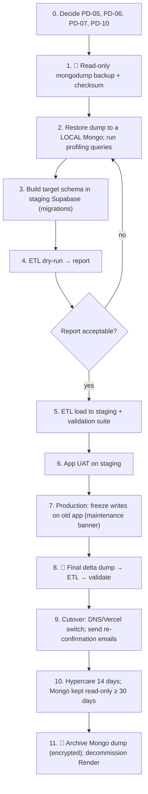

# MongoDB → Supabase Migration Strategy — NOT REQUIRED (reference only)

> **Update 2026-11-17: the product owner confirmed there is no production data (PD-06).** None of the ETL below will run. The new system starts empty, with seeded categories. This document is kept only as a record. The one step still relevant is taking the old MERN deployment offline (🔐).

> **Status:** plan only. Nothing has been exported, imported, created or deleted. **No connection has been made to MongoDB or Supabase.**
> Every step that touches a live system is marked 🔐 and needs explicit approval at execution time.
> The target schema is in [../architecture/DATABASE_ARCHITECTURE.md](../architecture/DATABASE_ARCHITECTURE.md) Part B. Decisions (PD-xx) are in [DECISIONS.md](DECISIONS.md).

## 0. First question: is there data to migrate? (PD-06)
The repository contains no data, seeds or fixtures. It's unknown whether the deployed app has real users.

| Answer | Path |
|---|---|
| **No real data** (test accounts only) | Skip the ETL. Seed categories and start fresh. Announce that test accounts need to sign up again. This is the simplest path and **removes most of this document** |
| **Real data exists** | Follow §1–§10 |

## 1. Source inventory (from the Mongoose models)
| Collection | Model file | Embedded / arrays | References | Expected issues (from the audit) |
|---|---|---|---|---|
| `users` | `Server/src/models/User.js` | `profilePhoto{url,public_id}`, `location{type,coordinates[]}` | — | `address` never set (BUG-02). Coordinates may be the Noida default (BUG-03). Plaintext `otp` (drop it). `isVerified` is untrustworthy (SEC-01). Possible duplicate emails differing only by case if they were created before `lowercase` |
| `services` | `models/Service.js` | `images[{url,public_id}]`, `location{…,address}` | `vendor → users` | The category enum. `whatsappNumber` in mixed formats. `vendor` references may point to deleted users |
| `bookings` | `models/Booking.js` | `customerLocation{type,coordinates,address}` | `service`, `customer`, `vendor` | `address` is "Home" (BUG-02). `service` may be orphaned (DB-03). Status `in-progress` |
| `reviews` | `models/Review.js` | — | `service`, `customer` | One per (service, customer). Must be linked to a booking (ADR-017). Possibly orphaned |
| `notifications` | `models/Notification.js` | — | `user` | Low value. Migrate or skip (PD-10) |

There are no other collections in the code. 🔐 The actual collection list is confirmed during profiling (§3).

## 2. Principles
1. **MongoDB is never modified or deleted.** The source is read-only, and data is exported once from a dump.
2. **Idempotent, re-runnable ETL.** Every load is keyed on `legacy_id_map`, so a re-run upserts instead of duplicating.
3. **Staging first.** Run the full rehearsal against a staging Supabase project at least twice before production.
4. **Validate before and after.** Record counts, referential checks, business-invariant checks and sampled diffs.
5. **Quarantine, don't drop.** Invalid records go to `migration.quarantine` with a reason, and are reviewed by hand.
6. **No PII in logs.** ETL logs carry IDs and counts only.

## 3. Phase plan

### 3.1 Backup 🔐
- `mongodump --uri <read-only user> --gzip --archive=veny-<date>.gz` using a **read-only** database user created for this purpose.
- Compute a SHA-256 checksum. Store the archive encrypted, with access restricted.
- Do a test restore into a local MongoDB before any ETL runs.

### 3.2 Profiling queries (run on the **local restore**, not production)
| Check | Purpose |
|---|---|
| Count per collection | Baseline for validation |
| Users where `location.coordinates == [77.391, 28.5355]` (and the `[77.2090, 28.6139]` dashboard fallback) | BUG-03 impact → `legacy_default` |
| Users where `role='vendor'` and `businessName` is missing | Data errors |
| Duplicate `lower(email)` | Auth import conflicts |
| Services whose `vendor` doesn't exist | Orphans |
| Bookings whose `service`, `customer` or `vendor` doesn't exist | Orphans (DB-03) |
| Bookings where `vendor ≠ service.vendor` | Integrity |
| Reviews with no completed booking for the same (service, customer) | ADR-017 mapping |
| Distinct `whatsappNumber` formats; vendors whose services have different numbers | Normalisation |
| `images` URLs: count and host (all Cloudinary?) | Image strategy |
| Range of `price` (negative, decimal, huge) | Conversion to paise |
| Coordinates outside lng [-180,180] / lat [-90,90], or swapped (lat in the lng slot: lng ≈ 28 and lat ≈ 77 for India) | Invalid coordinates |

The output is a profiling report that the product owner signs off before loading.

## 4. ID mapping
- Every target table uses `uuid` keys. The ETL creates `migration.legacy_id_map(collection text, mongo_id text, new_id uuid, primary key (collection, mongo_id))`.
- **Users are special:** the uuid comes from Supabase Auth when the auth user is created, and is then recorded in the map.
- Other entities: `new_id = gen_random_uuid()`, inserted into the map before the row, so every FK can be resolved by joining the map.
- `migration` is a separate schema that isn't exposed to PostgREST. Drop it after the retention window (🔐).

## 5. Transformation rules

### 5.1 Users → `auth.users`, `profiles`, `vendors`, `addresses`
| Source | Target | Rule |
|---|---|---|
| `email` | `auth.users.email` | lowercase + trim. Duplicates → quarantine |
| `password` (bcrypt `$2a$/$2b$`, cost 10) | `auth.users.encrypted_password` | Import through the Supabase Admin API with a password hash, if supported. **Requires Verification:** whether the current Supabase Auth Admin API accepts bcrypt hashes for `createUser`. **Fallback:** create the user without a password and require a reset ("Set your password") at first sign-in |
| `isVerified` | `email_confirmed_at` | **Set null for everyone (PD-05 recommended).** SEC-01 means past verification proves nothing. The first sign-in triggers a confirmation email |
| `otp`, `otpExpires` | — | Dropped |
| `name` | `profiles.full_name` | Trim. Pad or quarantine if shorter than 2 characters |
| `role` | `profiles.role` | `customer` or `vendor`, set by the ETL through service-role SQL, because the signup trigger isn't involved in an import |
| `businessName` | `vendors.business_name` | Required for vendors, otherwise quarantine |
| `phoneNumber` | `profiles.phone_e164` | Normalise (assume +91 for 10-digit numbers, PD-08). Unparseable → null + a report entry |
| `location.coordinates` | `addresses.location`, plus `vendors.base_location` for vendors | `ST_SetSRID(ST_MakePoint(lng, lat), 4326)::geography`. The Noida or Delhi fallback → `location_source='legacy_default'`. Swapped or invalid → null + `manual_unverified` |
| `address` | — | Never set (BUG-02). `addresses.line1` becomes "Address not provided" and `location_source` stays as computed. The user is prompted to complete it after migration |
| `profilePhoto.url` | `profiles.avatar_path` or external | Under ADR-019, keep the Cloudinary URL (add an `avatar_external_url` column, or keep `avatar_path` null and use the URL until the image job runs) |
| `createdAt` | `profiles.created_at` | Preserved |

### 5.2 Services → `services`, `service_images`
| Source | Target | Rule |
|---|---|---|
| `_id` | `services.id` | Through the map |
| `vendor` | `vendor_id` | Through the map. Missing → quarantine |
| `name` | `title` | Trim. Quarantine if shorter than 3 characters |
| `description` | `description` | Pad or quarantine if shorter than 10 characters |
| `price` | `price_paise` | `round(price * 100)`. Negative → quarantine |
| `category` | `category_id` | Join on the `categories` slug |
| `images[i]` | `service_images` (provider `cloudinary`, `external_url`, `external_public_id`, `position = i`) | At most 4 |
| `location` | `location` | As for users |
| `whatsappNumber` | `vendors.whatsapp_e164` | First valid number per vendor. Conflicts are reported |
| `averageRating`, `numOfReviews` | — | **Recomputed** after reviews load. Differences are reported |
| `isActive` | `is_active` | Copied |
| — | `slug` | Generated from the title plus a short suffix. Old `/service/:mongoId` URLs redirect (§8) |

### 5.3 Bookings → `bookings`, `booking_status_history`
| Source | Target | Rule |
|---|---|---|
| `service`, `customer`, `vendor` | FKs through the map | Orphaned service → **quarantine** (product decision: keep as history in a "deleted service" placeholder, or drop) |
| `status` | `status` | `in-progress` → `in_progress` |
| `scheduledDate` | `scheduled_at` | Copied. Past dates are allowed for historic rows, so **the `scheduled_at > created_at` check is created `NOT VALID` or applied only after the load**; otherwise historic rows would fail it |
| `customerLocation` | `address_location` + `address_snapshot = {"legacy": true, "text": <address or null>}` | "Home" → `text: null` |
| `totalPrice` | `price_paise` | ×100 |
| `createdAt`/`updatedAt` | `created_at`, plus a status timestamp approximated from `updatedAt` (`completed_at` / `cancelled_at`) | A single history row `(null → status, changed_by null, reason 'migrated')` |
| — | `reference` | Generated |

### 5.4 Reviews → `reviews`
- For each (service, customer) review, link `booking_id` = the latest booking with `status='completed'` for that pair. If there is none, quarantine it (the product owner decides).
- `rating` and `comment` are copied. `created_at` is preserved.
- After the load, run the rating recalculation for every service and compare with the old `averageRating`.

### 5.5 Notifications (PD-10)
- Recommended: **skip**. Users start with an empty inbox.
- Alternative: migrate the last 90 days, map `booking_inprogress` → `booking_in_progress`, `isRead` → `read_at = updatedAt`, and set `emailed_at = created_at` so nothing is re-sent.

## 6. Images: Cloudinary → Supabase Storage (ADR-019, PD-07)
| Option | How | Pros | Cons |
|---|---|---|---|
| **A. Keep the Cloudinary URLs (recommended for cutover)** | `service_images.provider='cloudinary'`, `external_url`. `next/image` remote pattern for `res.cloudinary.com` | No file copy, zero image loss, fast cutover | Two image providers for a while. The Cloudinary account must stay active |
| **B. Copy to Storage (post-cutover job)** | Edge Function or script: download each `external_url`, upload to `service-images/{vendor}/{service}/{uuid}.webp`, then update the row (`provider='supabase'`, `storage_path`). Idempotent per image ID | One provider; storage policies apply | Bandwidth and time; needs verification per image |
| C. Copy during cutover | B inside the cutover window | — | Longer freeze, more risk |

**Rule:** no Cloudinary asset is deleted until option B has run, every row is verified (an HTTP 200 from the Storage URL with a matching byte length) and the retention window has passed (🔐).

## 7. Validation suite (run on staging and production loads)
| Check | Pass criterion |
|---|---|
| Record counts | `source_count = loaded + quarantined` for each collection |
| Foreign keys | Guaranteed by constraints. Zero quarantined rows marked "missing FK" go unreviewed |
| Users can sign in | Sample of 20 accounts: the reset or confirmation flow works end to end (staging, test inboxes) |
| Booking invariants | `customer_id <> vendor_id`. Status timestamps are consistent. No vendor mismatch against the service |
| Rating recompute | Differences from Mongo `averageRating` are explained (orphans, quarantined reviews) |
| Geo | All non-null `location` values are valid. `legacy_default` count matches profiling |
| Images | Every `service_images.external_url` returns HTTP 200 (HEAD request, sampled or full) |
| RLS smoke | Run the RLS test suite against staging with migrated data |
| Spot diff | 25 random entities per collection compared field by field with the source |

## 8. Cutover & URL continuity
- Old SPA routes `/service/:mongoId` → a Next.js redirect (`middleware` or `redirects()`) using a `legacy_id_map` lookup, to `/services/{slug}` (301). This preserves shared links.
- `/explore` → `/services` (301).
- Production freeze: a maintenance banner on the old app, and write endpoints disabled. A deployment change on the old app needs 🔐.
- Communications: an email to all users explaining the security upgrade and that they need to re-confirm.

## 9. Rollback
| Stage | Rollback |
|---|---|
| Before DNS switch | Discard the staging or production Supabase data. The old app was never changed |
| After switch, within the hypercare window | Point DNS or Vercel back to the old frontend and Render API. Mongo is still intact, read-only during the freeze; re-enable writes. **Writes made in Supabase after cutover would be lost**, so keep the window short and consider exporting the new rows for manual replay |
| After the hypercare window | Forward-fix only |

## 10. Risks
| Risk | Mitigation |
|---|---|
| Bcrypt hash import not supported | Fallback: forced password reset (§5.1) |
| Re-confirmation causes churn | Clear messaging. Optionally a 7-day grace period with limited access (product decision) |
| Orphaned or invalid data larger than expected | Profiling first; quarantine review |
| Email deliverability at cutover (bulk re-confirmation) | Verified Resend domain with SPF, DKIM and DMARC; staged sending |
| Image hotlink breakage | Option A keeps the URLs; HEAD-check validation |
| PII exposure during ETL | Run locally or in CI with secrets; no dumps in the repo (`.gitignore`); delete working copies after |
