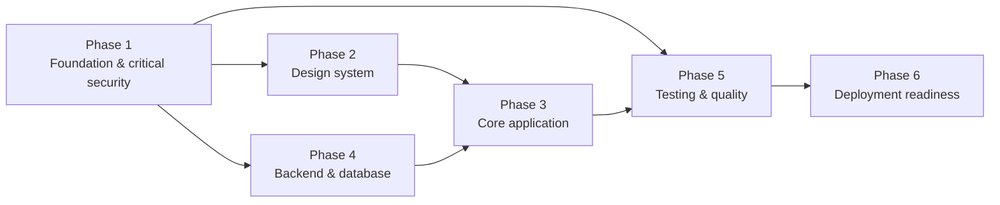
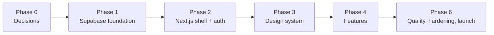

# Redesign & Modernization Roadmap

> **Document structure (revised 2026-11-17)**
> - **Part A: Original MERN modernisation roadmap.** **Superseded**, kept for reference. Its Phase 1 security fixes were kept as optional Phase 0b, which is now not needed (PD-06).
> - **Part B: Revised roadmap for the Supabase + Next.js rebuild.** This is the **current proposal**; jump to Part B.
>
> Decision status is tracked in [DECISIONS.md](DECISIONS.md).

# Part A — Original MERN roadmap (superseded)

> **Status: proposed. Not started.** Every phase needs approval before work begins.
> Complexity scale: S (≤ 3 days) · M (1–2 weeks) · L (2–4 weeks), for one full-stack developer.

Phase 5 starts in Phase 1, with a test harness and smoke tests, and runs continuously.

---

## Phase 1 — Foundation & critical fixes
**Goal:** a secure, correct, testable baseline without visual change.

| Task | Fixes |
|---|---|
| Move OTP fully server-side (generate with `crypto.randomInt`, hash, email via Resend from a verified domain, never return it); remove EmailJS and `frontendOtp` | SEC-01, SEC-02, SEC-08 |
| Add attempt limits and a strict auth rate limiter | SEC-08 |
| Fix `errorHandler` status mapping (AppError, Mongoose mapping) | BUG-01, SEC-13 |
| Request validation middleware (Zod) on auth, services and bookings; whitelist list filters; cap `limit` | SEC-03, SEC-04, SEC-10 |
| Owner filter on `markOneRead`; remove test routes; generic enumeration responses | SEC-09, SEC-11, SEC-12 |
| Escape email template values | SEC-07 |
| CORS allow-list from an environment variable | SEC-05 |
| `config/env.js` validation; `.env.example`; separate app from listen; await the database before listen; graceful shutdown | BE-05, DOC-01 |
| Conventions: Prettier, ESLint (server), EditorConfig, README, `engines` | process debt |
| Test harness (Vitest + Supertest + mongodb-memory-server) with auth and booking smoke tests | process debt |
| Verify V-04 (NoSQL operator casting) | V-04 |

- **Dependencies:** product decision on re-verifying existing accounts; a Resend verified sending domain.
- **Complexity:** M.
- **Risks:**
  - Email deliverability on Render, given the history of provider churn. Mitigation: Resend uses an HTTP API, so SMTP port issues don't apply.
  - Breaking current users mid-login during deploy.
- **Acceptance criteria:**
  - No API response contains an OTP. The `@emailjs/browser` import is removed.
  - Invalid input returns 400 or 422 with a field error; unknown routes return 404; invalid IDs return 400.
  - `?limit=100000` is capped, and `?isActive=false` or operator params are ignored.
  - Smoke tests pass in CI. `npm audit` shows no high or critical findings (or each one is documented).

---

## Phase 2 — Design system
**Goal:** tokens and accessible primitives before any screen redesign.

| Task |
|---|
| Choose visual direction A or B ([DESIGN_SYSTEM.md](../design/DESIGN_SYSTEM.md)), after the product owner answers the audience and market questions |
| Implement tokens in `@theme` (colour, type, spacing, radius, shadow, motion), with light and dark modes |
| Build primitives: Button, Input, Textarea, Select, Modal/Sheet, ConfirmDialog, Card, Badge/StatusBadge, Alert, Toast styling, Skeleton, EmptyState, Avatar, Rating, Tabs |
| Layout components: PublicLayout (auth-aware nav), DashboardLayout (sidebar + mobile tabs) |
| Optional: headless primitives (Radix) for Dialog, Popover and DropdownMenu |
| Accessibility gates: axe in component tests; contrast checks |

- **Dependencies:** Phase 1 conventions. The visual direction decision.
- **Complexity:** M.
- **Risks:** bikeshedding over the visual direction; building components nobody uses.
- **Acceptance criteria:**
  - Every primitive is documented with all its states.
  - Zero axe violations on the primitives.
  - Token contrast passes AA.
  - No raw hex values or arbitrary radii in new components.

---

## Phase 3 — Core application
**Goal:** rebuild the screens on the new system and fix the workflow bugs.

| Area | Tasks | Fixes |
|---|---|---|
| App shell | AuthProvider + `/me`; nested dashboard routes; lazy routes; error boundary | FE-02, FE-04, FE-07, PERF-07 |
| Auth | Login, signup and verify pages on the new form stack (RHF + Zod); password-manager friendly; `?role=vendor`; resend from the 403 state; *(if approved)* password reset | UX-05, UX-01 |
| Location | Geocode the manual address; no silent defaults; location editing in Settings | BUG-03, F-01 |
| Customer | Explore with server-side search, filter, pagination and "near me"; detail page with real trust signals; booking flow with address, notes and a login redirect; bookings timeline | BUG-04, F-02, UX-04, UX-06 |
| Vendor | Unified dashboard; bookings inbox; listing editor with per-image management; WhatsApp and contact fix | FE-01, BUG-05, BUG-06 |
| Shared | Notifications panel on TanStack Query; remove `window.confirm`; plain-language copy | PERF-03, UX-08 |
| Admin | **Only if approved**: moderation console | product decision |

- **Dependencies:** Phases 2 and 4 (API contract).
- **Complexity:** L.
- **Risks:** scope creep (payments, chat); regressions without e2e tests.
- **Acceptance criteria:**
  - Explore lists **all** active services, paginated.
  - A booking stores the real address.
  - The WhatsApp link works with a normalised number.
  - Editing images removes only the chosen ones.
  - Every dashboard section is deep-linkable.
  - Lighthouse accessibility ≥ 95 on key pages.

---

## Phase 4 — Backend & database
**Goal:** a modular backend with a consistent contract and sound data.

| Task | Fixes |
|---|---|
| Module structure (routes → controllers → services); move the state machine into a booking service | BE arch |
| Unified response envelope; versioned `/api/v1`; OpenAPI from Zod | BE-02 |
| Async notification and email dispatch | PERF-01, BE-01 |
| Schema changes *(each needs approval)*: structured address, `locationSource`, Booking `address`/`statusHistory`/`cancelReason`, `completedAt`, Service soft delete, hashed OTP or an `otp_tokens` collection with TTL | BUG-02, DB-03, DB-07, BE-08 |
| Data migration scripts (idempotent, dry-run first) for addresses, default coordinates and orphans | data debt |
| Indexes: add the query-backed ones; drop the unused ones after verification | PERF-06, DB-12, DB-13 |
| Pagination on all list endpoints | PERF-02 |
| Replace multer-storage-cloudinary; upgrade the Cloudinary SDK | dep debt |
| Structured logging (pino) with request IDs | BE-12 |
| Booking validations (future date, role policy, duplicate guard) | BE-03, DB-15 |
| Emit `review_new` | BE-06 |

- **Dependencies:** Phase 1 tests. Schema approval. A production data snapshot for migration rehearsal.
- **Complexity:** L.
- **Risks:** data migration on live data; contract changes breaking the old client. Mitigation: a version prefix, so the old routes stay available during the transition.
- **Acceptance criteria:**
  - Every endpoint returns the envelope.
  - The OpenAPI spec is published.
  - Every list endpoint is paginated.
  - Migrations are rehearsed on a copy.
  - `explain()` shows index use for the documented queries.

---

## Phase 5 — Testing & quality (continuous)
| Layer | Scope |
|---|---|
| Unit | Booking state machine, OTP service, permission policy, formatters |
| Integration/API | Supertest for every route: auth, ownership, validation errors |
| Component | RTL plus axe for the design-system primitives and key forms |
| E2E | Playwright: signup → verify → book → vendor confirm → complete → review |
| Security | Automated checks for OTP leakage, IDOR and operator injection; `npm audit` in CI; dependency bot |
| Responsive | Playwright viewports from RESPONSIVE_DESIGN.md; visual snapshots of key pages |
| Performance | Lighthouse CI budgets; bundle-size check |

- **Complexity:** M, spread across phases.
- **Acceptance criteria:**
  - CI runs lint, unit, API, build and e2e on every PR.
  - Coverage of at least 80% on the server service layer.
  - The e2e happy path is green.

---

## Phase 6 — Deployment readiness
| Task |
|---|
| Environment management: per-environment variables on Render and Vercel; secret rotation (JWT secret, Cloudinary, Resend), **recommended if any were ever exposed**; `NODE_ENV=production` verified |
| Build optimisation: code splitting verified, Cloudinary `f_auto,q_auto`, compression, caching headers |
| Health and readiness endpoints (database ping); graceful shutdown verified on deploy |
| Monitoring: Sentry for front and back; uptime check; structured logs to a drain |
| Deployment strategy: a staging environment; PR previews on Vercel; database backups before migrations; rollback plan |
| Legal: privacy policy and terms, given the PII shared between parties (emails, phones, addresses) |

- **Dependencies:** Phases 1–5.
- **Complexity:** S–M.
- **Risks:** cross-domain cookies if cookie auth is chosen; cold starts on the Render free tier (V).
- **Acceptance criteria:**
  - A staging environment mirrors production.
  - A documented runbook exists.
  - Alerts are configured.
  - A rollback has been rehearsed once.

---

# Part B — Revised roadmap: Supabase + Next.js rebuild (2026-11-17, CURRENT)

> **This is the current approved roadmap** (ADR-002 to ADR-019 approved 2026-11-17; PD-01 admin: yes; PD-06: no production data). Part A above (the MERN-in-place modernisation) is kept for reference and is **superseded**. The only exception is optional Phase 0b.
> Status: **proposed. Not started.** Every phase needs approval. Complexity is for one full-stack developer: S ≤ 3 days, M 1–2 weeks, L 2–4 weeks.

Testing runs continuously from Phase 1. Every phase ships with its tests.

## Phase 0 — Decisions (blocking)
- **Done:** ADR-002…ADR-019 approved; PD-01 (admin: yes); PD-06 (no production data).
- **Also done:** PD-03 (email + password), PD-11 (Pro for production), PD-12 (same repo), PD-13 (admin powers, option b). A Supabase project exists.
- **Also done:** PD-04 (vendor self-selection: yes). The existing project is **staging**.
- **Remaining scope:** PD-02, PD-08, PD-09, PD-14 (first admin, needed before production); the visual direction (DESIGN_SYSTEM A or B); the geocoding provider.
- **Acceptance:** PD-04 (it affects the sign-up trigger) and PD-14 (first admin) are answered before the Phase 1 functions migration. PD-02, PD-08 and PD-09 can be answered before Phase 4. The project's environment role (staging or production) is confirmed before any migration is applied.
- **Complexity:** S. **Risk:** analysis paralysis. Set a deadline.

## Phase 0b — NOT NEEDED (PD-06: no production data)

> Kept for reference. Instead, take the old deployment offline (🔐), as recommended in BUGS_AND_ISSUES.md.

Only if real users are on the MERN app and cutover is more than a few weeks away.
- Stop returning `otp` from signup and login, and send it server-side through the existing Resend path (SEC-01/02).
- Fix the `errorHandler` status mapping (BUG-01).
- **Complexity:** S. **Risk:** touching code that is being replaced. Keep it minimal.
- **Acceptance:** no OTP in any API response, checked by a manual curl.
- 🔐 Needs approval to modify the application source.

## Phase 1 — Supabase foundation
- **Status (2026-11-17):** done **locally**: migrations, seed, 92 pgTAP tests, advisors and a CI workflow. Not yet applied to staging (🔐). Staging Auth/SMTP/CAPTCHA settings are still to do.
- **Scope:**
  - Supabase CLI project in the repo (`supabase/`).
  - Migrations for the schema (DATABASE_ARCHITECTURE Part B §3–4), functions and triggers (§5), RLS and column grants (RLS_AUTHORIZATION §4), and Storage buckets and policies (§6).
  - Seed categories.
  - pgTAP or Vitest RLS and RPC test suite (RLS_AUTHORIZATION §9).
  - CI runs the local stack, tests and the Security/Performance Advisor.
  - Staging Supabase project 🔐.
  - Auth settings: email confirmation on, Resend SMTP with a verified domain, CAPTCHA, redirect allow-list.
- **Dependencies:** Phase 0; Resend domain DNS access.
- **Complexity:** L.
- **Risks:** RLS gaps (mitigated by negative tests); SQL skill ramp-up.
- **Acceptance:**
  - Every table has RLS.
  - The negative-test list passes.
  - The Advisor reports no errors.
  - `create_booking`, `transition_booking` and `create_review` are covered by tests for all transitions and eligibility rules.
  - Generated types are committed.

## Phase 2 — Next.js app shell & authentication
- **Scope:**
  - `apps/web` (TypeScript strict, ESLint, Prettier).
  - `@supabase/ssr` clients and middleware.
  - Route groups `(public)`, `(auth)`, `(dashboard)`.
  - Sign-up (role choice, `?role=vendor`), sign-in, confirm, resend, reset password, sign-out.
  - Role-aware dashboard layout guard.
  - `lib/errors.ts` + `ActionResult`.
  - `error.tsx` / `not-found.tsx`.
  - Security headers / CSP.
  - Vercel preview deploys against staging.
- **Dependencies:** Phase 1.
- **Complexity:** M.
- **Risks:** cookie and session edge cases; email deliverability.
- **Acceptance:**
  - E2E: sign up → confirm via a test inbox → sign in → dashboard → sign out.
  - No code or token appears in any network response body.
  - The service-role key is absent from the client bundle (CI grep).

## Phase 3 — Design system
- **Scope:** tokens in Tailwind v4 `@theme`; shadcn/ui components themed to DESIGN_SYSTEM; `PublicLayout` and `DashboardShell` (sidebar plus mobile tabs); accessibility gates (axe); a light/dark decision.
- **Dependencies:** Phase 0 visual direction; Phase 2 shell.
- **Complexity:** M.
- **Acceptance:** primitives documented with all states; zero axe violations; AA contrast for every token pair.

## Phase 4 — Feature rebuild
| Slice | Scope | Fixes |
|---|---|---|
| 4.1 Catalogue (public, SEO) | Explore with `search_services` (q, category, price, near me, pagination); service detail by slug with gallery, reviews, JSON-LD; category and vendor pages; sitemap | BUG-04, F-02, FE-13, UX-04 |
| 4.2 Vendor listings | Create and edit with RHF + Zod; image manager (signed uploads, reorder, delete); pause; soft delete | BUG-06, SEC-04, DB-03 |
| 4.3 Addresses & location | Address book; geocoding action (provider decision); vendor base location and radius | BUG-02, BUG-03, F-01 |
| 4.4 Booking | Booking form (slot, address, notes) → `create_booking`; customer bookings list and detail with timeline; cancel with reason; contact via `get_booking_contact` (WhatsApp fix) | BUG-02, BUG-05, BE-03, UX-06 |
| 4.5 Vendor inbox | Incoming bookings with Realtime; transitions via `transition_booking`; earnings by `completed_at` | FE-01, BE-08, PERF-03 |
| 4.6 Reviews | Eligibility query; `create_review`; edit and delete own reviews; vendor notification | BE-06 |
| 4.7 Notifications | Bell and panel with TanStack Query + Realtime; mark read; email Edge Function with escaping | SEC-07, SEC-09, PERF-01 |
| 4.8 Profile & settings | Profile, avatar, phone (E.164), account deletion function | — |
| 4.9 Admin (**in scope**: PD-01 approved) | Admin console: vendor verification and suspension, hide reviews and listings, a bookings overview with admin cancel, category management, an audit log. Powers per PD-13 (b): verify and suspend vendors, hide reviews and listings, view all bookings, cancel bookings from any non-terminal state, and manage categories | — |

- **Dependencies:** Phases 1–3.
- **Complexity:** L.
- **Risks:** scope creep (payments, chat). Keep them out (PD-09).
- **Acceptance:** each slice has passing E2E happy and negative paths; Lighthouse accessibility ≥ 95 and SEO ≥ 95 on public pages.

## Phase 5 — Data migration: REMOVED (PD-06: no production data)

> Kept for reference only. The new system starts empty, with seeded categories.

- **Scope:** everything in [MONGODB_TO_SUPABASE_MIGRATION.md](MONGODB_TO_SUPABASE_MIGRATION.md): backup 🔐, profiling, ETL scripts, quarantine, a validation suite, two staging rehearsals, legacy URL redirects, the re-confirmation email plan.
- **Dependencies:** PD-05, PD-06, PD-07, PD-10; Phase 1 schema. **Skipped entirely if there is no production data.**
- **Complexity:** M (L if the data is messy).
- **Risks:** bcrypt import support; data quality; email churn.
- **Acceptance:** two clean rehearsals; validation suite green; rollback rehearsed once.

## Phase 6 — Quality, hardening & launch
- **Scope:**
  - Full Playwright suite including the responsive matrix (RESPONSIVE_DESIGN).
  - Security review: RLS audit, key scan, CSP.
  - Load test of `search_services` and `create_booking` on staging.
  - Sentry.
  - Production Supabase on a paid plan with PITR backups (Requires Verification of plan features).
  - Vercel production domain.
  - Launch on the production Supabase and Vercel domain. There is no data cutover. 🔐 Take the old MERN deployment offline.
  - Hypercare.
  - Decommission Render 🔐.
  - Archive the legacy code (tag, then move to `legacy/` or a branch; not deleted without approval).
- **Dependencies:** Phase 4.
- **Complexity:** M.
- **Acceptance:**
  - Zero high or critical findings.
  - Rollback plan rehearsed.
  - Monitoring alerts configured.
  - 14-day hypercare without a Sev-1.
