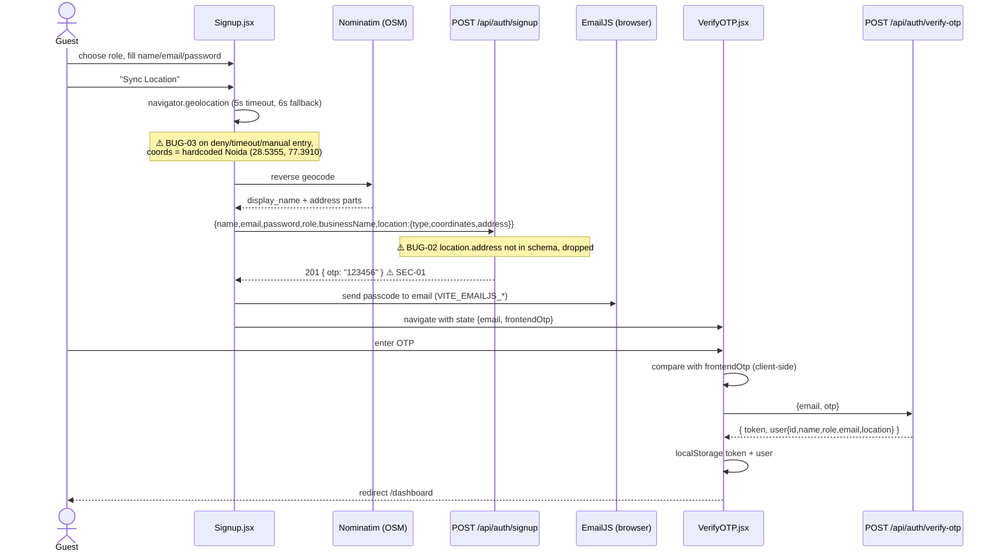
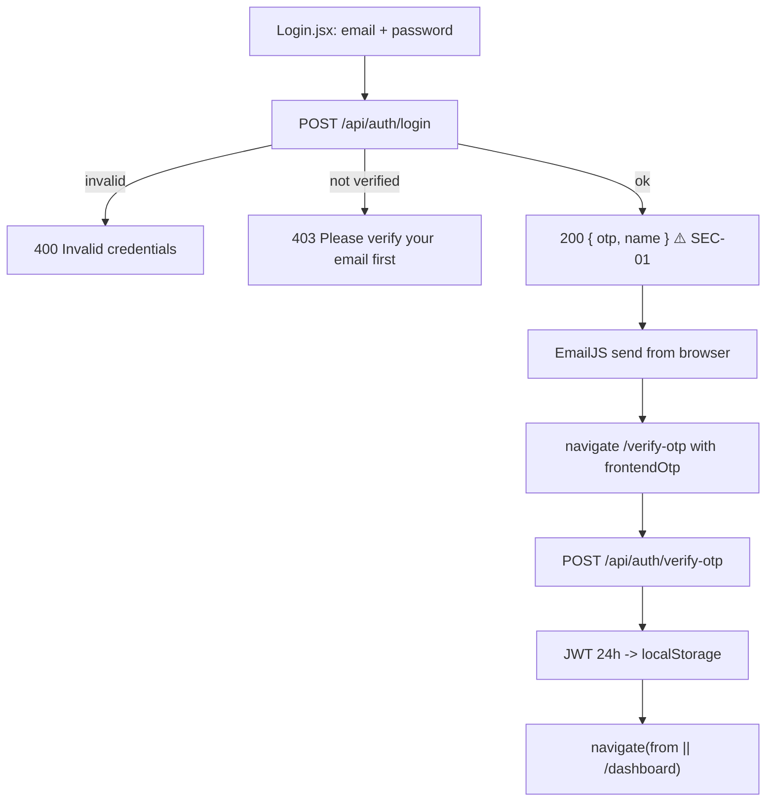
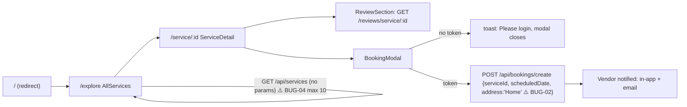
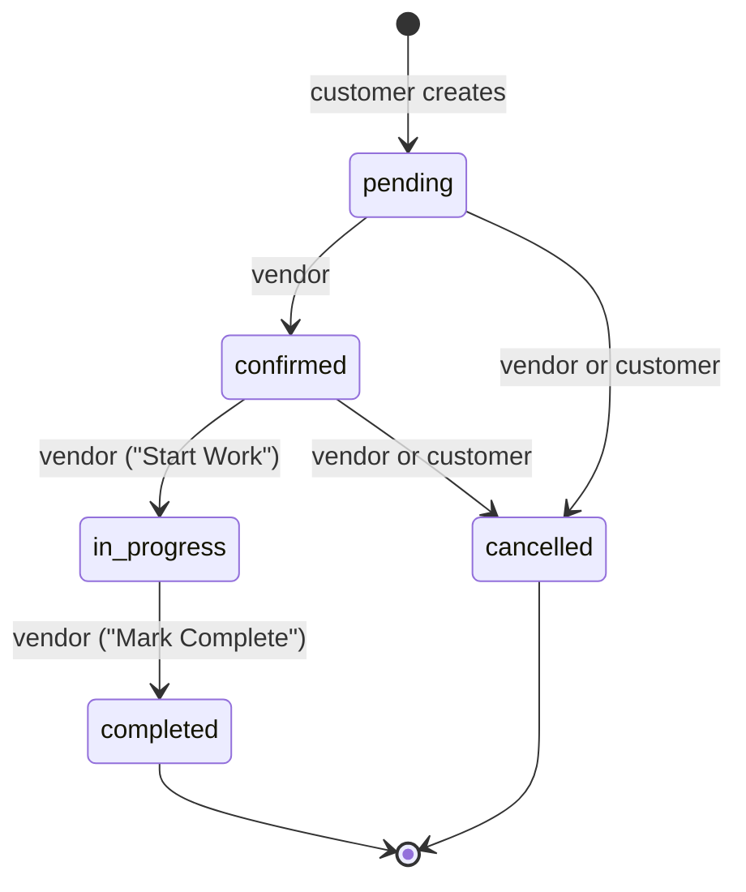
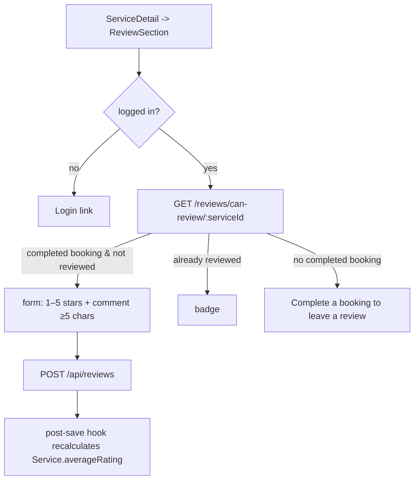
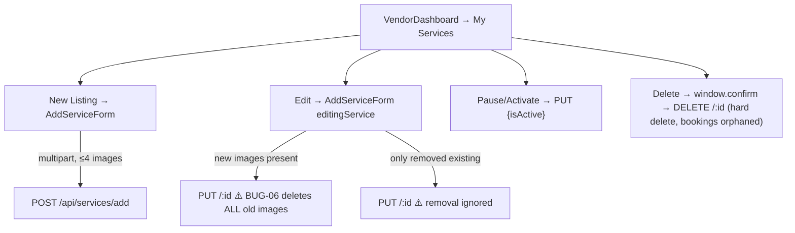

# User Flows

All flows describe **current behaviour**. ⚠️ marks a confirmed defect, with its ID from [BUGS_AND_ISSUES.md](../audit/BUGS_AND_ISSUES.md).

## 1. Signup + email verification

**Problems on this flow:**
- Anyone can verify an email they don't own, because the OTP is in the API response (SEC-01).
- If EmailJS fails, the account is still created but left unverified. Signing up again then fails with "User already exists". The user's only way out is to log in, which sends a new OTP.
- A user who refreshes `/verify-otp` loses the router state and is redirected to `/login` (`VerifyOTP.jsx:19-21`).

## 2. Login (password + OTP)

- An unverified user who gets the 403 has no button to resend the OTP. They'd have to know to sign up again, and that fails.

## 3. Browse → detail → book

- A guest who clicks "Initiate Mission" only sees a toast. Nothing redirects them to login or brings them back afterwards.

## 4. Booking lifecycle

Source: `Server/src/controllers/bookingController.js:118-143`. Each transition creates a notification for the other party (`bookingController.js:149-189`). On `completed`, the notification links to `/service/:id` and invites a review.

- No cancellation reason is recorded.
- Nothing handles no-shows, rescheduling or disputes.
- The customer can't contact the vendor because the WhatsApp button never shows (⚠️ BUG-05). The vendor sees the customer's `phoneNumber`, but only if the customer set one in their profile.

## 5. Review

## 6. Vendor service management

## 7. Notifications

- The bell polls `GET /api/notifications` every 30s while a token exists (`NotificationBell.jsx:37-42`).
- Clicking an item marks it read and navigates to `notif.link`.
- The bell is **only** mounted inside the dashboards. Public pages never show it.

## Missing / inconsistent workflows
| Gap | Evidence |
|---|---|
| Password reset | No route exists |
| Resending the OTP from the login 403 state | `Login.jsx` handles only an error string |
| Changing location or address | `profileController.js:23` |
| Returning to the dashboard from public pages | Navbar links are fixed to Explore, Login and Signup (`Navbar.jsx:13-17`) |
| "Join as Vendor" CTA | Opens `/signup` with the role preset to customer (`Navbar.jsx:46`, `Signup.jsx:121`) |
| Login prompt from booking | Only a toast (`BookingModal.jsx:30-33`) |
| A vendor viewing their own bookings as a customer | `bookingController.js:72` |
| Duplicate Explore entry points | The dashboard "Explore" menu item and the CTA both navigate away from the dashboard layout |
